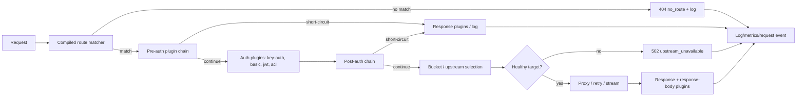

# API Request Path

An API gateway request is matched against an immutable runtime snapshot, passes pre-auth and post-auth plugin chains, is routed to a healthy upstream target, and is logged and counted after the response completes. The LLM and MCP path routers run before this catch-all, so this view only covers requests that reach the API gateway.

## Steps

1. **Resolve the snapshot.** The handler takes the current `GatewayRuntime` snapshot. In-flight requests keep this snapshot even if a reload swaps a newer one.
2. **Match.** The matcher evaluates protocol, host (exact or a single `*.` wildcard pattern), path (prefix or regex), method, and headers. Routes are ordered by `regex_priority` descending, longest path descending, then id ascending. A miss returns `404 no_route`, records metrics, writes an access log, and publishes an `api.request.completed` event when a subscriber exists.
3. **Pre-auth plugins.** The chain contains global, service, route, and non-consumer-specific instances. It can short-circuit before authentication; response plugins still run for the short-circuit.
4. **Authenticate.** `key-auth`, `basic-auth`, `jwt`, and `acl` plugins resolve a consumer and credential. The chain is split at authentication so consumer- and consumer-group-scoped instances can replace the less specific instance in the post-auth pass, matching Kong's precedence.
5. **Post-auth plugins.** The chain applies the 12-level Kong scope precedence and can modify headers, the URI, the method, or the body. It can short-circuit; response plugins still run.
6. **Select a target.** The Service resolves to a direct endpoint or an Upstream pool. The pool filters disabled and unhealthy targets, then orders attempts by round-robin, weighted round-robin, consistent hashing, least-connections, or latency EWMA. The request hash supports header, cookie, query, URI capture, client IP, and consumer inputs. Sticky target cookies are paired with an HMAC-signed `<name>.sig` cookie; a tampered target is ignored and the pair is reset. Rate limiting is local-only; `cluster`/`redis` policies are rejected rather than silently degraded.
7. **Bound retries.** Attempts are truncated to `1 + service.retries` and to the pool size. Non-idempotent methods are buffered and may retry only a connection failure, before any request bytes reached the upstream; after a request was sent they are not retried. An upstream HTTP error is not retried by the proxy. A route with `request_buffering = false` keeps a single attempt.
8. **Proxy.** The request path is stripped when configured, the Host header is preserved or replaced, hop-by-hop headers are sanitized, and the body is streamed unless buffering is required for retries or a body-mutating plugin. Header-only `key-auth` instances do not request the body; `key_in_body = true` opts in. The body is capped by `gateway.max_body_bytes`.
9. **Response plugins.** Response and response-body phases run in order. A plugin can replace the response or rewrite the body. The response body is buffered only when a plugin instance declares that it needs body mutation and the route's `response_buffering` is enabled; header-only response-transformer instances pass the upstream body through.
10. **Account.** The handler records status, latency, route, service, target, consumer, and error to `request_logs`, updates JSON/Prometheus metrics, emits an event, and runs the log-phase plugins.

## Error paths

- No route: `404 no_route`.
- Route without a service, or service without an upstream: `502 upstream_unavailable`.
- No eligible target: `502 upstream_unavailable`.
- Body over the limit: `413 payload_too_large`.
- Plugin failure: the plugin's fail-open/fail-closed policy decides; a closed failure returns `500 plugin_error`.

## Drift instrument

Drift caught by: the integration tests in `crates/octra-api-gateway/tests/proxy.rs`, the matcher and balancer unit tests in `crates/octra-runtime`, and inspection of `crates/octra-api-gateway/src/data.rs`. A future fixture should assert the phase order for a request that passes through auth, a body transformer, and a response transformer.
