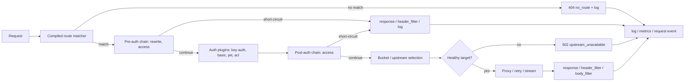

# API Request Path

An API gateway request is matched against an immutable runtime snapshot, passes pre-auth and post-auth plugin chains, is routed to a healthy upstream target, and is logged and counted after the response completes. The LLM and MCP path routers run before this catch-all, so this view only covers requests that reach the API gateway.

## Steps

1. **Resolve the snapshot.** The handler takes the current `GatewayRuntime` snapshot. In-flight requests keep this snapshot even if a reload swaps a newer one.
2. **Match.** The matcher evaluates protocol, host (exact or a leading `*.` wildcard pattern), path (prefix or regex), method, and headers. Routes are ordered by `regex_priority` descending, longest path descending, then id ascending. A miss returns `404 no_route`, records metrics, writes an access log, and publishes an `api.request.completed` event when a subscriber exists.
3. **Pre-auth phases.** The chain contains global, service, route, and non-consumer-specific instances. `rewrite` and `access` can short-circuit before authentication; response phases still run for the short-circuit.
4. **Authenticate.** `key-auth`, `basic-auth`, `jwt`, and `acl` plugins resolve a consumer and credential. The chain is split at authentication so consumer- and consumer-group-scoped instances can replace the less specific instance in the post-auth pass, matching Kong's precedence.
5. **Post-auth access.** The chain applies the 12-level Kong scope precedence. The host buffers the complete request body before `access`, subject to `gateway.max_body_bytes`; `request_body()` returns it and `set_request_body()` replaces it and updates `Content-Length`. There is no request-body chunk phase.
6. **Internal upstream.** A Service tagged `llm:internal` is served in-process: the handler skips target selection, retries, HTTP timeouts, and sticky sessions, reconstructs the request from the mutated parts and buffered body, and calls the `InternalUpstream` handle. Global plugin instances are skipped for this service. Response phases still run on the returned response.
7. **Select a target.** The Service resolves to a direct endpoint or an Upstream pool. The pool filters disabled and unhealthy targets, then orders attempts by round-robin, weighted round-robin, consistent hashing, least-connections, or latency EWMA. The request hash supports header, cookie, query, URI capture, client IP, and consumer inputs. Sticky target cookies are paired with an HMAC-signed `<name>.sig` cookie; a tampered target is ignored and the pair is reset. Rate limiting is local-only; `cluster`/`redis` policies are rejected rather than silently degraded.
8. **Bound retries.** Attempts are truncated to `1 + service.retries` and to the pool size. Non-idempotent methods are buffered and may retry only a connection failure, before any request bytes reached the upstream; after a request was sent they are not retried. An upstream HTTP error is not retried by the proxy.
9. **Proxy.** The request path is stripped when configured, the Host header is preserved or replaced, hop-by-hop headers are sanitized, and the body is streamed unless buffering is required for retries or a body-mutating plugin. Header-only `key-auth` instances do not request the body; `key_in_body = true` opts in. The body is capped by `gateway.max_body_bytes`.
10. **Response phases.** `response` may replace the response; `header_filter` may change status and headers; `body_filter` receives every response chunk plus EOF, in priority order. Each body plugin mutates `chunk` directly. Full-body plugins buffer chunks in their request-scoped plugin context and emit the complete result at EOF. The host does not pre-buffer or share full bodies; `Content-Length` is removed when body filtering is active, and a late body-filter failure cannot change the status.
11. **Account.** The handler records status, latency, route, service, target, consumer, and error to `request_logs`, updates JSON/Prometheus metrics, emits an event, and runs `log`. There is no `error` plugin phase.

## Error paths

- No route: `404 no_route`.
- Route without a service, or service without an upstream: `502 upstream_unavailable`.
- No eligible target: `502 upstream_unavailable`.
- Body over the limit: `413 payload_too_large`.
- Plugin failure before response commit: the plugin's fail-open/fail-closed policy decides; a closed failure returns `500 plugin_error`.
- Plugin failure in `body_filter` after commit: the response body is truncated or aborted and the failure is logged; the status cannot be changed.

## Drift instrument

Drift caught by: the integration tests in `crates/api_gateway/octra-api-gateway/tests/proxy.rs` (including streaming and full-body plugin fixtures), the matcher and balancer unit tests in `crates/octra-runtime`, and inspection of `crates/api_gateway/octra-api-gateway/src/data.rs`. A future fixture should assert the full Kong phase order for a request that passes through auth, a request transformer, and a response transformer.
