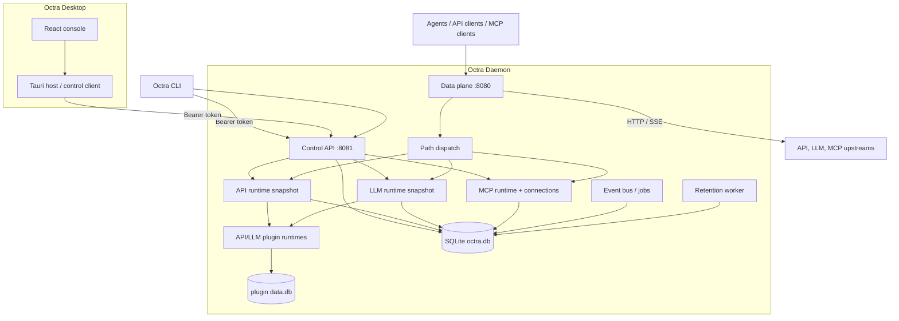

# Containers

The runnable pieces are a Tauri desktop app and an independent daemon. The daemon owns the control plane, the shared data listener, the API/LLM/MCP runtimes, the plugin runtimes, the durable event bus, the retention worker, and SQLite. The desktop and CLI are control-plane clients.

## Containers

**Desktop app.** Tauri 2 host + React console. The host holds the control token and exposes one path- and method-allow-listed `daemon_request` command; the webview uses the shared `ControlApiClient`. Browser-only mode uses the same client with a local settings token.

**CLI.** A Rust client over the control API: `status`, `services`/`routes`/`upstreams`/`targets` CRUD, `mcp` servers/tools/keys/ACLs CRUD, `reload`, `doctor`, `keys`, `usage`, and `ai` status/actions plus full CRUD for providers, accounts, models, targets, policies, and attachments. Bodies accept inline JSON, `-` for stdin, or `@path` for a file. It prints JSON and reads the control token from `OCTRA_CONTROL_TOKEN` or `$OCTRA_HOME/control.token`.

**Control plane (`:8081`).** Shared Bearer auth, CORS, and audit middleware in front of:
- `/api/v1/system/*` (health, config, overview, reload),
- `/admin/*` (Kong-shaped API admin, plugin artifacts/lifecycle, schemas, logs, metrics, reload),
- `/admin/llm/*` (virtual keys, usage, plugins, PII),
- `/api/v1/mcp/*` (servers, tools, sessions, invocations, keys, ACLs),
- `/api/v1/agents/*` (detection, preview/apply/restore, profiles, backups),
- `/admin/events`, `/admin/jobs`.

**Data plane (`:8080`).** One listener with path dispatch: LLM owns `/v1/*` and `/v1beta/*`, MCP owns `/mcp` and `/mcp/`, and the API gateway is the fallback. See [Data-Plane Dispatch](data-plane-dispatch.md).

**API runtime.** An immutable snapshot of services, routes, upstreams, targets, consumers, credentials, ACLs, and plugin chains. The matcher, target pools, health state, and auth maps are compiled once and swapped on reload (ADR 0017).

**LLM runtime.** An immutable snapshot compiled from the AI-native control plane: providers, accounts, models, targets, virtual keys, policies, and plugin chains. The account pool keeps live quota/cooldown/pacing state across reloads (ADR 0013). ADR 0018 Phase 11 makes `ai_*` the only model control plane, adds per-target model metadata, built-in AI policy execution through the LLM plugin chains (including prompt compression and semantic response caching for JSON and streaming responses), semantic target routing, and provider query parameters. Applying or rolling back a revision reloads the runtime and plugin chains. See [LLM Control Plane](llm-control-plane.md).

**MCP runtime.** Server definitions, lazy stdio/HTTP connections keyed by the full definition, tool discovery, session storage, API keys, ACLs, and invocation audit (ADR 0014).

**Plugin runtimes.** Native Rust and WASM plugin registries for the API and LLM gateways, with host-owned per-plugin storage, capability approval, events, and jobs (ADR 0005, ADR 0006, ADR 0009).

**Event bus.** A SQLite-backed outbox and per-subscriber delivery rows with exponential backoff, plus a scheduled-job reconciler.

**Retention worker.** A background task that prunes request logs, audit logs, LLM usage, usage rollups, MCP invocations, and terminal plugin events.

**SQLite.** `$OCTRA_HOME/octra.db` with WAL, foreign keys, a busy timeout, `0600` permissions on Unix, and ordered SQLx migrations. Plugin data lives in separate per-plugin databases.

## Why the daemon is independent

The gateway must keep serving while the GUI reloads, crashes, or is closed, and the CLI must work without a WebView. The Tauri host therefore contains no gateway logic and the daemon has no GUI dependency (ADR 0003). The cost is that the desktop requires an operator-started daemon and packaging must eventually add lifecycle supervision.

## Drift instrument

Drift caught by: inspection of `crates/octra-daemon/src/main.rs`, the Tauri bridge, and the control/data router wiring. No generated container graph is wired yet.
