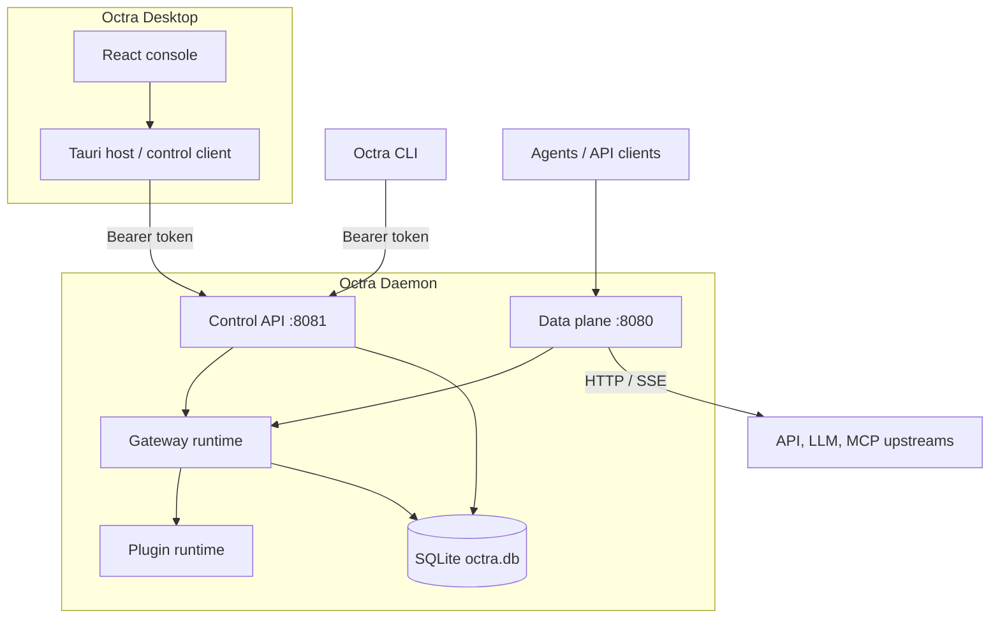

# Containers

The runnable pieces are a Tauri desktop app and an independent daemon; the daemon owns the control plane, the data plane, the gateway runtime, the plugin runtime, and SQLite.

## Drift instrument

Drift caught by: inspection of `crates/octra-daemon/src/main.rs` and the Tauri sidecar commands; no generated container graph is wired yet.
