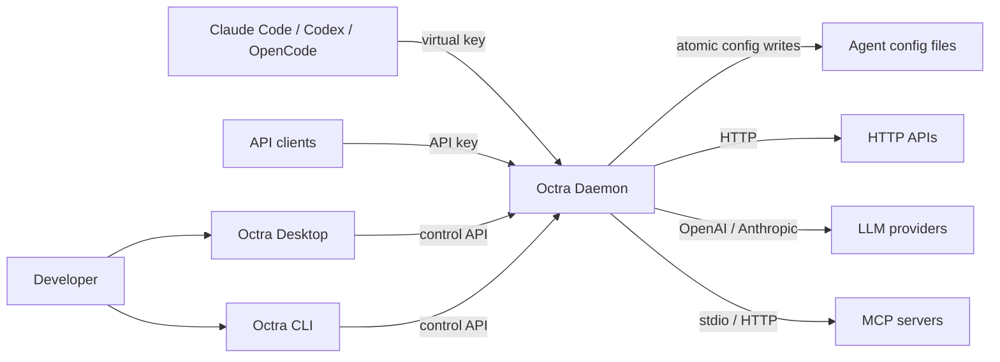

# Context

Octra sits between local users and agents on one side and HTTP APIs, LLM providers, and MCP servers on the other; the desktop app and CLI manage one local daemon.

## Drift instrument

Drift caught by: inspection of the listener and adapter wiring in `crates/octra-daemon/src/main.rs`; this view has no generated conformance check yet.
