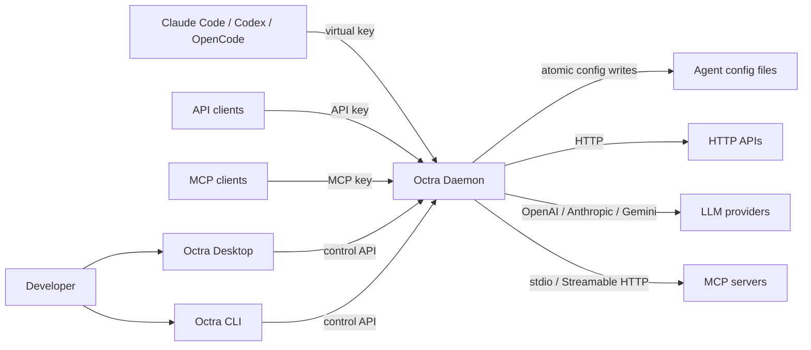

# Context

Octra sits between local users and agents on one side and HTTP APIs, LLM providers, and MCP servers on the other. The desktop app and CLI manage one local daemon. The daemon is the only component that holds provider credentials, the control token, and the SQLite database.

## Reference models

Octra is a local-first composite of three external models. The detailed adopt/not-adopt matrix and implementation status live in [Reference Models](reference-models.md).

- **API gateway:** Kong Gateway's service/route/upstream/target model, route priority, plugin phases/scopes, load balancing, health checks, and Admin API shape (ADR 0011, ADR 0012).
- **LLM gateway:** yetone/magpie's local multi-protocol gateway, routing groups, provider-account failover, privacy masking, and usage/cost model (ADR 0013).
- **MCP gateway:** Kong's AI MCP Proxy fronting and aggregation model, narrowed to passthrough/listener behavior with stdio and HTTP upstreams (ADR 0014).

## Trust boundaries

- The data listener is unauthenticated at the transport level; the API gateway, LLM gateway, and MCP gateway each enforce their own credential (API key, virtual key, or MCP key) depending on configuration. All bind loopback by default.
- The control listener requires the Bearer control token on every request. The token is admin-only and is never issued to an agent.
- The desktop webview never holds the control token in packaged mode; the Tauri host bridges allow-listed requests (ADR 0015).
- Provider secrets are references, not values. OAuth tokens, KeyAuth keys, BasicAuth passwords, and JWT secrets are sealed with AES-256-GCM under an OS-keychain-backed master key (ADR 0007).
- Third-party plugins run as WASM components with approved capabilities; native plugins are first-party and compiled in (ADR 0005, ADR 0006).

## Drift instrument

Drift caught by: inspection of the listener and router wiring in `crates/octra-daemon/src/main.rs`, the Tauri bridge in `apps/desktop/src-tauri/src/lib.rs`, and the reference matrix in `reference-models.md`. This view has no generated conformance check yet.
