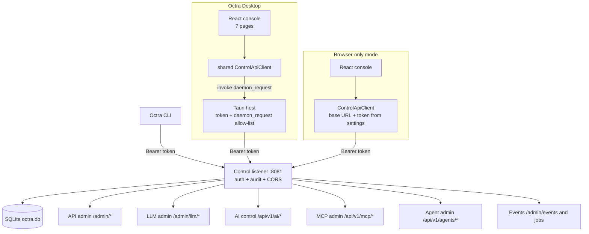

# Control Plane and Desktop Console

The control plane is an authenticated HTTP API on loopback. The desktop console, the CLI, and any external admin client use the same API. The Tauri host holds the token; the webview never does in packaged mode.

## Desktop pages

| Page | Route | Data | Mutations |
|---|---|---|---|
| Overview | `/` | health, overview range, config, traffic chart | reload snapshot |
| API Gateway | `/gateway` | services, routes, upstreams, targets, metrics | Typed forms for services/routes/upstreams/targets, with advanced JSON for headers/healthchecks |
| LLM Gateway | `/llm` | usage, providers, consumer policies | typed consumer-policy CRUD |
| AI Control | `/ai-control` | AI status, providers, accounts, models, targets, policies, attachments, revisions | typed forms for all six entity types, OAuth start/complete/refresh/clear, validate, apply, rollback |
| Agents | `/agents` | agents, mode, profiles, routes, virtual keys, backups | create/update/delete profile, preview, apply, restore |
| MCP Gateway | `/mcp` | servers, tools, keys, auth strategies, ACLs, invocations, sessions | Typed forms for servers/tools/keys/ACLs/OIDC strategies, including `type`/`sources`/`route_path`, CEL allow/deny, ACL scopes, and conversion OpenAPI config in advanced JSON |
| Plugins | `/plugins` | LLM plugins and stage metrics | enable/disable |
| Settings | `/settings` | control connection, daemon lifecycle, local PII model, local data | daemon start/stop/restart; PII model on/off/download/cancel/remove/score |

The UI is therefore a **live console plus targeted editors**. AI Control has typed forms for all six AI entity types plus activation/rollback and OAuth start/complete/refresh/clear with a loopback callback listener, the API Gateway and MCP pages have typed forms for their core entities with advanced JSON for free-form fields, the LLM page has a typed consumer-policy form, and Settings can start/stop/restart a bundled daemon sidecar. The Kong-shaped Admin API, the `/api/v1/ai/*` control API, and the CLI cover part of that gap; the CLI exposes `status`, API Gateway services/routes/upstreams/targets CRUD, MCP servers/tools/keys/ACLs CRUD, consumer-policy CRUD, `reload`, `doctor`, `keys`, `usage`, and full AI entity CRUD plus activation actions.

## AI control plane

`/api/v1/ai/*` exposes CRUD for AI providers, accounts, models, targets, policies, and attachments, plus `status`, `validate`, `preview`, `apply`, `revisions`, and `rollback`. It is mounted under the same Bearer/audit layer. The AI-native control plane is the only model/routing/account/policy source: the runtime compiles `ai_*` at startup, executes policies through the plugin chains (including prompt compression and semantic response caching), ranks targets with the `semantic` strategy, and reloads the runtime and plugin chains after apply/rollback. There is no legacy/shadow/on switch and no import-legacy path. See [LLM Control Plane](llm-control-plane.md).

## Tauri bridge

The host reads `OCTRA_CONTROL_TOKEN` or `$OCTRA_HOME/control.token`, resolves `daemon.control_bind` from `$OCTRA_HOME/config.toml`, and exposes one `daemon_request(method, path, body)` command. It accepts only `/api/v1/` and `/admin/` paths and GET/POST/PUT/DELETE. The webview calls it through `desktopFetch`; the shared `ControlApiClient` is otherwise identical to browser mode.

## CLI

The CLI resolves the control URL from `--control-url`, `OCTRA_CONTROL_URL`, or the local config, reads the token from `OCTRA_CONTROL_TOKEN` or `control.token`, and prints JSON. `doctor` checks local paths and daemon reachability. Virtual-key commands print the plaintext key exactly once.

## Audit and reload

Control mutations pass through the audit middleware. API, LLM, and MCP mutating handlers reload their runtime before returning; a reload failure is surfaced as a control-plane error and the previous snapshot keeps serving. The event bus uses the same control listener for `/admin/events` and `/admin/jobs`.

## Drift instrument

Drift caught by: inspection of `apps/desktop/src/app/App.tsx`, `apps/desktop/src/lib/control-api.ts`, `apps/desktop/src-tauri/src/lib.rs`, `crates/octra-cli/src/main.rs`, and the control routers in `crates/octra-*`. A future test should assert that every page's queries hit a documented control path and that the Tauri allow-list rejects everything else.
