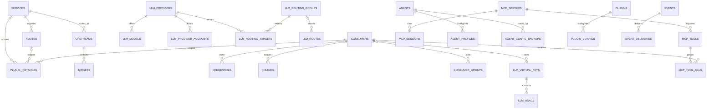

# Data Model

The persisted entity map for `$OCTRA_HOME/octra.db`; `migrations/` is the authority for columns and constraints, and this view names the relationships a reader needs before changing the schema.

**Three planes.** Identity and governance (`consumers`, `credentials`, `consumer_groups`, `policies`, `llm_virtual_keys`) are separate from routing (`services`/`routes`/`upstreams`/`targets`, `llm_routes`/`llm_routing_groups`/`llm_routing_targets`/`llm_providers`/`llm_models`) and from accounting (`llm_usage`, `request_logs`, `audit_logs`, `events`/`event_deliveries`). A foreign key between planes is rare by design; they meet in accounting rows.

**Nullable scope.** `policies.consumer_id` is null for a global policy. `plugin_instances.service_id`, `route_id`, and `consumer_id` are nullable scope selectors. `llm_routes.routing_group_id` is nullable, so a route can exist before a group is attached.

**Soft accounting references.** `llm_usage` records `api_key_id`, `virtual_model_id`, `provider_id`, `account_id`, and `model_id` as historical labels rather than enforced foreign keys, so deleting configuration does not erase usage history.

**Cascades.** Configuration children cascade with their parent (`upstreams` -> `targets`, `plugins` -> `plugin_configs`, `mcp_servers` -> `mcp_tools`, `events` -> `event_deliveries`). Agent config backups are retained independently of the `agents` table and capped at 20 per agent; audit logs are bounded by the retention worker. Neither is removed by a configuration parent cascade.

**Standalone tables.** `request_logs`, `audit_logs`, `mcp_invocations`, `plugin_jobs`, and `settings` have no enforcement foreign keys in the current schema; they are append-only or operational records.

## Drift instrument

Drift caught by: SQLx migrations are the only DDL source, and `cargo test -p octra-storage` applies every migration to a fresh database; schema changes must update this view in the same change.
