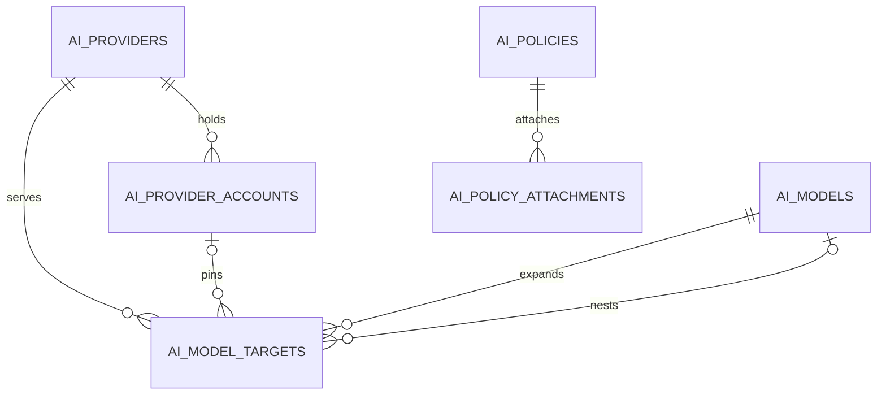

# Data Model

`migrations/` is the authority for columns and constraints. This view names every persisted table, the relationships a reader needs before changing the schema, and the tables that are intentionally append-only or operational.

```mermaid
erDiagram
    SERVICES ||--o{ ROUTES : exposes
    SERVICES ||--o{ PLUGIN_INSTANCES : scopes
    ROUTES ||--o{ PLUGIN_INSTANCES : scopes
    CONSUMERS ||--o{ PLUGIN_INSTANCES : scopes
    CONSUMER_GROUPS ||--o{ PLUGIN_INSTANCES : scopes
    UPSTREAMS ||--o{ TARGETS : contains
    CONSUMERS ||--o{ CONSUMER_GROUP_CONSUMERS : joins
    CONSUMER_GROUPS ||--o{ CONSUMER_GROUP_CONSUMERS : contains
    CONSUMERS ||--o{ KEYAUTH_CREDENTIALS : owns
    CONSUMERS ||--o{ BASICAUTH_CREDENTIALS : owns
    CONSUMERS ||--o{ JWT_SECRETS : owns
    CONSUMERS ||--o{ ACLS : owns
    CONSUMERS o|--o{ POLICIES : scopes
    CONSUMERS o|--o{ LLM_VIRTUAL_KEYS : owns
    LLM_PROVIDERS ||--o{ LLM_MODELS : offers
    LLM_PROVIDERS ||--o{ LLM_PROVIDER_ACCOUNTS : holds
    LLM_PROVIDER_ACCOUNTS ||--o| LLM_PROVIDER_OAUTH_TOKENS : refreshes
    LLM_PROVIDERS ||--o{ LLM_ROUTING_TARGETS : serves
    LLM_PROVIDER_ACCOUNTS o|--o{ LLM_ROUTING_TARGETS : pins
    LLM_ROUTING_GROUPS ||--o{ LLM_ROUTING_TARGETS : selects
    LLM_ROUTING_GROUPS o|--o{ LLM_ROUTES : aliases
    MCP_SERVERS ||--o{ MCP_TOOLS : exposes
    MCP_SERVERS ||--o{ MCP_SESSIONS : anchors
    MCP_TOOLS ||--o{ MCP_TOOL_ACLS : grants
    CONSUMERS ||--o{ MCP_TOOL_ACLS : receives
    CONSUMERS o|--o{ MCP_API_KEYS : owns
    PLUGINS ||--o{ PLUGIN_CONFIGS : configures
    PLUGIN_ARTIFACTS o|--o{ PLUGINS : packages
    EVENTS ||--o{ EVENT_DELIVERIES : delivers
```

The diagram shows enforced foreign keys. `llm_usage`, `llm_usage_rollup`, `event_deliveries`, `agent_profiles`, and `agent_config_backups` also carry logical references that are intentionally not enforced, because history and operator records must survive configuration deletion. In particular, agent profiles and backups use a logical `agent_id` rather than an enforced foreign key.

## Planes

**Identity and governance.** `consumers`, `consumer_groups`, `consumer_group_consumers`, the three credential child tables (`keyauth_credentials`, `basicauth_credentials`, `jwt_secrets`), `acls`, `policies`, and `llm_virtual_keys`. `policies.consumer_id` is null for a global policy; a consumer policy and the global policy both apply, and a model/provider must pass every applicable policy. `llm_virtual_keys.key_family` and `rotated_from` preserve rotation lineage; `permissions_json` carries allowed models/providers/accounts and hourly/daily/weekly/monthly token or cost limits.

**API routing.** `services`, `routes`, `upstreams`, `targets`, and `plugin_instances`. `services.host`/`port`/`path` identify the upstream endpoint; a service can point at an upstream virtual host instead. `upstreams` is global (not owned by a service) and carries the algorithm, hash inputs, slots, and `healthchecks` JSON. `targets.target` is a URL string; `targets.weight` is the relative capacity. `plugin_instances` is the API plugin configuration table; `service_id`, `route_id`, `consumer_id`, and `consumer_group_id` are nullable scope selectors, and the unique index covers all four.

**LLM routing and accounting.** `llm_providers`, `llm_models`, `llm_provider_accounts`, `llm_provider_oauth_tokens`, `llm_routing_groups`, `llm_routing_targets`, `llm_routes`, `llm_virtual_keys`, `llm_usage`, `llm_usage_rollup`, `llm_pii_engines`, `llm_plugin_state`, `llm_counters`, and `llm_budget_windows`. A route's `virtual_model_id` is unique; `routing_group_id` is nullable so a route can exist before a group is attached. A target points at a provider, model, optional account, weight, priority, and position. `llm_usage` keeps `api_key_id`, `virtual_model_id`, `provider_id`, `account_id`, and `model_id` as historical labels rather than enforced foreign keys, so deleting configuration does not erase usage history. `llm_usage_rollup` is a `WITHOUT ROWID` hourly aggregate keyed by bucket and dimensions. `llm_counters` and `llm_budget_windows` are short-lived shared counters for rate limits and budget guards.

**MCP.** `mcp_servers`, `mcp_tools`, `mcp_sessions`, `mcp_tool_acls`, `mcp_api_keys`, and `mcp_invocations`. `mcp_servers.transport` is `stdio` or `http`; `config_json` and `headers_json` keep transport configuration and secret references. `mcp_tools` is unique per `(server_id, name)` and stores the input schema. `mcp_sessions.server_id` is non-null, so a gateway session is anchored to the first enabled server even though it spans the aggregate. `mcp_tool_acls` is unique per `(tool_id, consumer_id)`; a tool with no rows follows the open-local default. `mcp_api_keys` stores a prefix and hash, never the key.

**Agents.** `agents`, `agent_profiles`, and `agent_config_backups`. A profile is unique per `(agent_id, name)` and may reference a virtual key and a config path. A backup stores the exact original content, original/applied SHA-256, whether the file existed, and a restore timestamp; backups are capped at 20 per agent and are not removed by an agent cascade.

**Plugins and events.** `plugins`, `plugin_configs`, `plugin_artifacts`, `plugin_instances`, `llm_plugin_state`, `events`, `event_deliveries`, and `plugin_jobs`. `plugins`/`plugin_configs` are the LLM plugin catalog and scope configuration; `plugin_instances` is the API plugin configuration; `plugin_artifacts` stores the installed WASM artifact, hash, signature, manifest, path, and size. `events` is the durable outbox; `event_deliveries` is one row per subscriber with status, attempts, next attempt, last error, and delivered time. `plugin_jobs` is the reconciled cron schedule with last status, last error, attempts, and next run.

**Operational.** `request_logs`, `audit_logs`, `mcp_invocations`, `settings`, and `llm_plugin_state` have no enforced parent foreign keys. `request_logs` and `audit_logs` are append-only and retention-bounded; `settings` stores the schema version and small key/value state. `llm_plugin_state` is host-maintained opaque JSON for stateful LLM plugins.

## Cascades and retention

- Configuration children cascade with their parent: `services` -> `routes` and `plugin_instances`; `routes` -> `plugin_instances`; `consumers` -> credentials, ACLs, virtual keys, and MCP ACLs/keys; `ai_providers` -> accounts and model targets; `ai_provider_accounts` -> OAuth tokens; `ai_models` -> model targets; `mcp_servers` -> tools and sessions; `mcp_tools` -> ACLs; `plugins` -> plugin configs; `plugin_artifacts` -> plugin rows via `SET NULL`; `events` -> deliveries.
- Agent config backups are retained independently of `agents`; the storage layer keeps the newest 20 per agent. Audit logs and request logs are bounded by the retention worker, not by a parent cascade.
- Plugin-owned data lives in separate SQLite files under the plugin storage root (ADR 0006), not in the control database.
- The control database and its WAL/SHM sidecars are `0600` on Unix because OAuth tokens and agent backups may contain credentials.

## Secrets

- Static provider secrets are stored only as `env:` / `file:` references and resolved at request time.
- OAuth access and refresh tokens are the deliberate exception: they persist in `ai_provider_oauth_tokens` in plaintext for now and inherit the database's `0600` protection.
- Virtual keys, API keys, and MCP keys store a display prefix plus a SHA-256 hash, never the plaintext.
- The control API masks or omits secret values and never returns backup content or virtual-key plaintext after creation.

### AI control-plane tables

ADR 0018 replaced the legacy route/group-oriented LLM tables with the AI-native schema in `migrations/0023_ai_control_plane.sql`. The `ai_*` tables are the only model, routing, account, and policy control plane; `migrations/0026_drop_legacy_llm_models.sql` removed `llm_providers`, `llm_models`, `llm_routing_groups`, `llm_routes`, `llm_routing_targets`, `llm_provider_accounts`, and the legacy OAuth table.

`ai_config_revisions` is a standalone append-only revision log. `snapshot_json` stores the full control plane for rollback; `diff_json` stores the applied entity counts. `ai_model_targets` is constrained so a target is either a nested model (`target_model_id`) or a provider target (`provider_id` + `upstream_model`), and carries the upstream `context_window`, `max_output_tokens`, `capabilities_json`, and `pricing_json` that used to live in `llm_models`. `ai_policy_attachments` is unique per policy/scope/scope id. `ai_model_targets.semantic_description` feeds the `semantic` routing strategy through `LlmRuntimeData::target_semantic_descriptions`, keyed by the synthesized target id. Semantic-cache entries are runtime state, not control-plane entities: the plugin persists a bounded JSON entry list in `llm_plugin_state` under `llm-semantic-cache:{config-id}`, and streamed responses are reconstructed into canonical responses before they are stored.

The remaining `llm_*` tables are not model control plane: `llm_virtual_keys` (LLM authentication and allowlists), `llm_usage`/rollups (telemetry), `llm_budget_windows`/`llm_counters` (runtime counters), `llm_plugin_state` (plugin state), and `llm_pii_engines` (local detection engines).

## Drift instrument

Drift caught by: SQLx migrations are the only DDL source, and `cargo test -p octra-storage` applies every migration to a fresh database. Schema changes must update this view in the same change. The current migration set is `0001_init.sql` through `0026_drop_legacy_llm_models.sql`.
