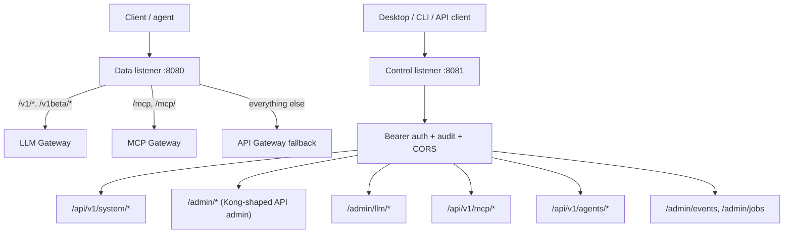

# Data-Plane Dispatch

Octra runs one data listener and one control listener. The data listener is shared by three gateways; their routes are merged in a fixed order so a request belongs to exactly one of them. The control listener is partitioned by owner, but shares one Bearer token, one CORS layer, and one audit middleware.

## Data listener

The daemon merges the routers in this order:

1. `octra-llm-gateway::data_plane_router` owns `/v1/chat/completions`, `/v1/responses`, `/v1/messages`, `/v1/messages/count_tokens`, `/v1/models`, `/v1beta/models`, and `/v1beta/models/{model}:{action}`.
2. `octra-mcp-gateway::data_plane_router` owns `/mcp` and `/mcp/` (POST, GET, DELETE).
3. `octra-api-gateway::data_plane_router` is the catch-all fallback. It only sees requests not claimed by LLM or MCP.

The listener binds loopback by default (`127.0.0.1:8080`) and accepts a shared body limit, connect/request timeouts, and a trusted-proxy configuration. API requests are matched against the compiled route matcher; LLM and MCP requests are dispatched by path.

## Control listener

The control listener binds loopback by default (`127.0.0.1:8081`). Every endpoint requires the control Bearer token. The shared audit middleware records control mutations. The route groups are:

- `/api/v1/system/*`: health, config, overview, reload.
- `/admin/*`: Kong-shaped API admin (services, routes, upstreams, targets, consumers, consumer groups, plugins, credentials, ACLs, schemas, status, metrics, logs, audit logs, reload, plugin artifacts and lifecycle).
- `/admin/llm/*`: providers, models, routing groups, routes, virtual keys, accounts, usage, plugins, PII engines/models, reload.
- `/api/v1/mcp/*`: servers, tools, sessions, invocations, keys, ACLs.
- `/api/v1/agents/*`: detection, config preview/apply/restore, profiles, backups.
- `/admin/events`, `/admin/jobs`: durable event outbox and scheduled jobs.

## Ownership rule

A new endpoint belongs to the gateway that owns the protocol, not to the daemon. The daemon only mounts the routers and supplies shared state (storage, config, token, audit, CORS, event bus). This keeps the LLM and MCP gateways independent of the API gateway's Admin API and lets each crate test its own router.

## Drift instrument

Drift caught by: inspection of the router merge order in `crates/octra-daemon/src/main.rs` and the route tables in `crates/octra-llm-gateway/src/data_plane/mod.rs`, `crates/octra-mcp-gateway/src/data.rs`, and `crates/octra-api-gateway/src/admin/mod.rs`. A future integration test should assert that every documented path prefix resolves to the expected owner.
