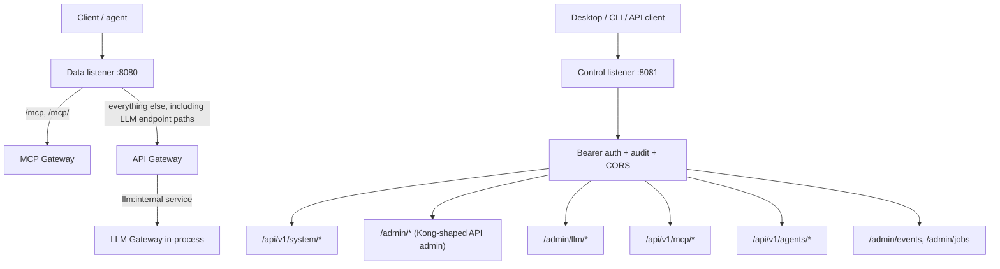

# Data-Plane Dispatch

Octra runs one data listener and one control listener. The data listener is owned by the API gateway; MCP is a sibling router, and the LLM gateway is an in-process upstream reached through an API route. The control listener is partitioned by owner, but shares one Bearer token, one CORS layer, and one audit middleware.

## Data listener

The daemon merges the routers in this order:

1. `octra-mcp-gateway::data_plane_router` owns `/mcp` and `/mcp/` (POST, GET, DELETE).
2. `octra-api-gateway::data_plane_router` is the catch-all. It owns API routes and, at `/v1` and `/v1beta`, the LLM gateway routes.

The LLM router is not mounted on the public listener. The daemon provisions a `llm-gateway` API service tagged `llm:internal` and one exact route per supported OpenAI, Anthropic, and Gemini endpoint (`/v1/chat/completions`, `/v1/responses`, `/v1/messages`, `/v1/messages/count_tokens`, `/v1/models`, `/v1beta/models`, and the Gemini `:generateContent` / `:streamGenerateContent` / `:countTokens` actions). The API gateway matches those routes and calls the LLM router in-process through `InternalUpstream`; it skips endpoint selection, retries, HTTP timeouts, and sticky sessions for the internal service. See [ADR 0020](../adr/0020-route-llm-traffic-through-the-api-gateway.md).

The listener binds loopback by default (`127.0.0.1:8080`) and accepts a shared body limit, connect/request timeouts, and a trusted-proxy configuration. All requests are matched against the compiled API route matcher.

## Control listener

The control listener binds loopback by default (`127.0.0.1:8081`). Every endpoint requires the control Bearer token. The shared audit middleware records control mutations. The route groups are:

- `/api/v1/system/*`: health, config, overview, reload.
- `/admin/*`: Kong-shaped API admin (services, routes, upstreams, targets, consumers, consumer groups, plugins, credentials, ACLs, schemas, status, metrics, logs, audit logs, reload, plugin artifacts and lifecycle).
- `/admin/llm/*`: providers, models, routing groups, routes, virtual keys, accounts, usage, plugins, PII engines/models, reload.
- `/api/v1/mcp/*`: servers, tools, sessions, invocations, keys, ACLs.
- `/api/v1/agents/*`: detection, config preview/apply/restore, profiles, backups.
- `/admin/events`, `/admin/jobs`: durable event outbox and scheduled jobs.

## Ownership rule

A new endpoint belongs to the gateway that owns the protocol, not to the daemon. The daemon only mounts the routers and supplies shared state (storage, config, token, audit, CORS, event bus). LLM protocol handling still belongs to the LLM gateway; the API gateway owns the HTTP front door, including CORS, IP restriction, correlation IDs, and request-size limits. The LLM router is reached only through the `llm:internal` service.

## Drift instrument

Drift caught by: inspection of the router merge order in `crates/octra-daemon/src/main.rs`, the LLM route provisioning in `crates/octra-daemon/src/llm_upstream.rs`, the in-process branch in `crates/api_gateway/octra-api-gateway/src/data.rs`, and the route tables in `crates/llm_gateway/octra-llm-gateway/src/data_plane/mod.rs` and `crates/octra-mcp-gateway/src/data.rs`. `crates/octra-daemon/tests/llm_routes.rs` and `crates/api_gateway/octra-api-gateway/tests/internal_upstream.rs` assert the front-door behavior.
