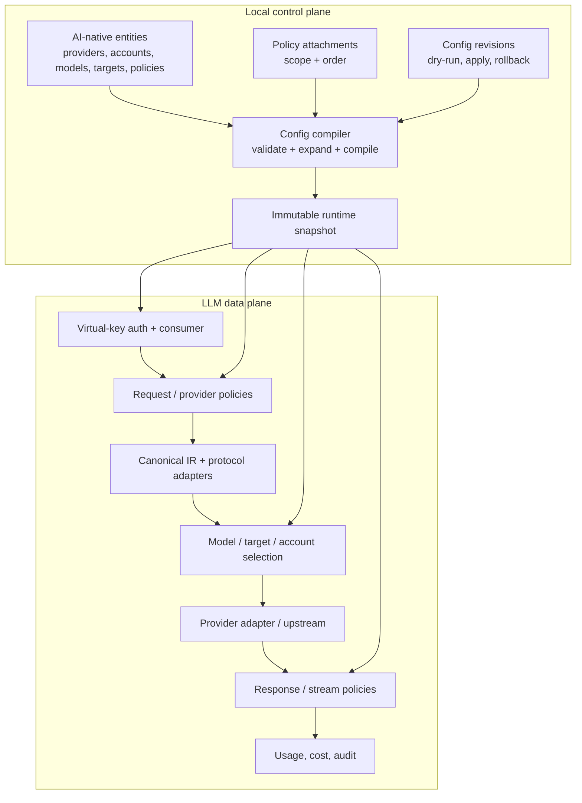

# LLM Control Plane

> **Status: Phase 12 landed; AI-native only. Neural semantic features and protocol breadth pending.** The `ai_*` schema, compiler, `AiStore`, `/api/v1/ai/*` CRUD, validate/preview/apply/revisions/rollback, revision snapshots, transactional replace, the AI-native runtime mapping, built-in policy execution for every policy type (including PromptGuard, PromptCompress, and SemanticCache), semantic target routing, provider query parameters, streaming cache population and SSE replay, AI-native account OAuth with exposed status/expiry and desktop controls, cache/routing observability, full CRUD CLI with stdin/file bodies, and typed desktop forms for every AI entity exist and are tested. The legacy `llm_*` model control plane, `/admin/llm/*` model endpoints, `legacy`/`shadow`/`on` modes, `auto_import_legacy`, and import-legacy compatibility path have been removed without backward compatibility. Remaining `llm_*` tables are auth, usage, counters, plugin state, PII-engine, and OAuth-token state, not model control plane. Neural embedding-based semantic routing and new wire-protocol adapters remain future work.

The LLM control plane separates three concerns that are currently mixed:

1. **Entities** — providers, accounts, virtual models, targets, policies, consumers, and keys.
2. **Compilation** — validating entities and turning them into an immutable runtime snapshot.
3. **Execution** — the data plane that authenticates, translates protocols, applies policies, selects targets/accounts, and records usage.

The design borrows Kong AI Gateway 2.x's AI-native entity separation and policy attachments, but keeps Octra's local-first deployment: one daemon, SQLite, one control listener, one data listener, and no required external service.



## Entity model

| Entity | Purpose | Key fields |
|---|---|---|
| `ai_providers` | Reusable upstream provider | protocol, base URL, auth reference, capabilities, non-secret config |
| `ai_provider_accounts` | Static, OAuth, or CLI credential | provider, credential kind, secret/OAuth reference, weight, priority, quota, cooldown |
| `ai_models` | Client-facing virtual model or group | name, kind (`model`/`group`), capabilities, formats, route paths, balancer |
| `ai_model_targets` | Target inside a model | provider + upstream model or nested model, weight, priority, position, account pin, context window, max output tokens, capability flags, pricing, semantic description, config |
| `ai_policies` | Typed policy | type, validated config, enabled |
| `ai_policy_attachments` | Bind policy to scope | scope type/id, order, enabled |
| `consumers` / `consumer_groups` | Existing identity model | reused as AI consumer/group |
| `llm_virtual_keys` | Hashed client key | model/provider/account allowlists, token/cost limits |
| `ai_config_revisions` | Config generation | actor, diff, status, rollback target |
| `coding_agents` / `agent_profiles` / `agent_config_backups` | Claude Code / Codex / OpenCode integration | separate from A2A `ai_agents` |

### Model kinds and nesting

- `kind=model` is a virtual model whose targets reference provider + upstream model.
- `kind=group` is a routing group; a target may reference another model (`target_model_id`) to form a nested group.
- The compiler rejects cycles, missing references, and groups deeper than the configured maximum. Expansion order is deterministic: target priority, position, then id.
- A target may pin an account; otherwise the account pool selects one using the model's balancer strategy.

## Policy model

Policies are typed and stream-aware. The engine distinguishes:

- **Additive constraints** — allowlists, token/cost limits, rate limits, PII redaction, prompt guard. All applicable policies run; the strictest result wins.
- **Transformations** — system prompt, model map, parameter override, prompt template. Policies execute in a deterministic order; a more specific scope may override a less specific one.

Scope precedence:

```text
virtual_key > consumer > consumer_group > target > model > provider > global
```

Security policies run before transformations. Response and stream policies run in reverse order. A policy cannot write SQLite directly; it uses host capabilities and the request-scoped state.

Initial policy types (all implemented):

- `rate-limit`
- `budget-guard`
- `pii-redaction`
- `prompt-guard`
- `prompt-compress` (local deterministic compression)
- `semantic-cache` (local lexical similarity by default, optional OpenAI-compatible embeddings)
- `model-map`
- `param-override`
- `system-prompt`
- `request-audit`
- `think-tags`
- `allowlist` (mapped into the runtime's consumer/virtual-key policy checks)

## Compilation and revisions

The compiler is a local component, not a remote control plane:

1. Load entities from SQLite.
2. Validate references, capabilities, formats, policy types, and graph shape.
3. Compile provider catalog, account pools, model plans, policy chains, and pricing.
4. Create an `ai_config_revisions` row with a diff and status.
5. Swap the immutable snapshot atomically.

The control API supports `validate`, `preview`, `apply`, and `rollback`. A failed compile leaves the previous snapshot serving. The data plane keeps the snapshot it started with for in-flight requests.

## magpie feature mapping

| magpie feature | Target model |
|---|---|
| Provider presets / custom provider | `ai_providers` + `ai_provider_accounts` |
| Subscription accounts | `ai_provider_accounts.credential_kind=oauth`; tokens in `ai_provider_oauth_tokens` |
| Routing groups | `ai_models.kind=group` + `ai_model_targets.target_model_id` |
| smart/order/rotate/usage/pace/manual | `ai_models.balancer_json.strategy` |
| weight/free/fast/drain/cheap/expiring | strategy extensions; not all in the first implementation |
| Account failover / quota / cooldown | account pool + target selection |
| Session affinity | session header + `ai_sessions` or account affinity state |
| Privacy masking | `pii-redaction` policy |
| Usage / cost / quota | `llm_usage` + rollups + virtual-key limits |
| Coding-agent config | `coding_agents` domain, not `ai_agents` |
| JS middleware / plugins | typed policies; native/WASM for custom code |
| Remote sharing / Docker | optional deployment mode, not core |

## Migration outcome

The migration is complete and intentionally not backward compatible. The legacy model/routing/account tables were dropped:

| Removed | Replaced by |
|---|---|
| `llm_providers` | `ai_providers` |
| `llm_models` (upstream profile/capabilities/pricing) | `ai_model_targets` metadata (`context_window`, `max_output_tokens`, `capabilities`, `pricing`) |
| `llm_routes` + `llm_routing_groups` | `ai_models` (`kind=model` or `group`) |
| `llm_routing_targets` | `ai_model_targets` |
| `llm_provider_accounts` | `ai_provider_accounts` |
| `llm_provider_oauth_tokens` | `ai_provider_oauth_tokens` |
| `llm_*` model control endpoints | removed; `/api/v1/ai/*` is the only model control API |

Remaining `llm_*` tables are deliberately outside the model control plane: `llm_virtual_keys` (LLM authentication and allowlists), `llm_usage`/rollups (telemetry), `llm_budget_windows`/`llm_counters` (runtime counters), `llm_plugin_state` (plugin state), and `llm_pii_engines` (local detection engines). They may be renamed in a later cleanup, but they do not define models or routing.

## Current status

| Capability | Status |
|---|---|
| AI Provider / Account entities | Schema, storage, compiler, CRUD API, AI-native runtime mapping, exposed OAuth status/expiry, and AI-native OAuth start/complete/refresh/status/delete implemented; legacy model/account tables and endpoints removed |
| AI Model / Target entities | Schema, storage, compiler, CRUD API, AI-native runtime mapping, nested groups, and per-target context/capability/pricing metadata implemented |
| AI Policy / Attachment CRUD | Schema, storage, compiler validation, CRUD API, Allowlist mapping, and built-in plugin execution for every policy type |
| Prompt policy execution | PromptGuard blocks or masks matching prompts; PromptCompress normalizes whitespace, deduplicates adjacent text, and truncates under a character budget |
| Semantic response cache | Exact canonical keys plus local lexical similarity, optional OpenAI-compatible embeddings with fallback, TTL/LRU bounds, consumer/virtual-key scoping, non-streaming JSON and streaming SSE cache hits, stream reconstruction through `on_final_response`, `X-Octra-Cache` headers, request-audit `cache_status`, and `llm_plugin_state` persistence |
| Semantic target routing | `semantic` balancer ranks targets by local lexical similarity against AI-native `semantic_description`; nested groups inherit descriptions and targets without descriptions score by health |
| Provider configuration breadth | `config_json` supports `wire`, `headers`, `auth_header`, `query`, OAuth, and CLI providers; query pairs are appended to every upstream endpoint |
| Config compiler + revisions | Compiler, revision snapshots, apply, rollback, and transactional replace implemented |
| Nested groups / cycle validation | Compiler and runtime mapping expand nested models; cycles/depth overflow are rejected |
| Policy scope precedence | Compiler helper implements the target order; executable policies compile into the existing LLM plugin chains |
| Daemon integration | AI-native only; startup compiles `ai_*`, and apply/rollback reload the runtime and plugin chains. No legacy/shadow/on mode, no auto-import |
| CLI / Desktop | Full CRUD for providers/accounts/models/targets/policies/attachments; `octra ai` accepts inline, stdin, and file JSON bodies; typed desktop forms for all six AI entity types; no legacy model commands or import-legacy |
| magpie routing strategies | `order`/`rotate`/`usage`/`quota`/`pace`/`smart`/`intent` plus an Octra-native `semantic` strategy; `manual`/`weight`/`fast`/`cheap` remain unimplemented; see ADR 0013 |
| Coding-agent integration | Implemented separately from the LLM control plane; keep separate |

Phase 11 evidence:

- `migrations/0023_ai_control_plane.sql` creates the seven `ai_*` tables; `0024_ai_revision_snapshot.sql` adds revision snapshots; `0025_ai_target_model_metadata.sql` adds target context/capability/pricing metadata; `0026_drop_legacy_llm_models.sql` creates `ai_provider_oauth_tokens` and drops the legacy model tables.
- `crates/octra-ai-config/` contains the entity types, compiler, and validation tests.
- `crates/octra-storage/src/ai.rs` provides CRUD/replace/revision APIs, target metadata, and AI account quota/cooldown methods.
- `crates/octra-llm-gateway/src/ai_control.rs` exposes `/api/v1/ai/*` CRUD, validate/preview/apply/revisions/rollback, and reloads the runtime and plugin chains after activation.
- `crates/octra-llm-gateway/src/ai_runtime.rs` maps AI-native entities and per-target metadata onto the compiled runtime model, including nested group flattening and Allowlist policies.
- `crates/octra-llm-gateway/src/ai_policy_plugins.rs` maps executable AI policies to synthetic LLM plugin records and configs, including PromptGuard, PromptCompress, and SemanticCache.
- `crates/octra-llm-plugin-runtime` supports `reload_with_extra` so AI policies join the normal plugin chains without being persisted.
- `crates/octra-llm-plugin-builtin/src/prompt_guard.rs` implements `llm-prompt-guard` with block/mask modes, regex and keyword rules, and configurable scan flags.
- `crates/octra-llm-plugin-builtin/src/prompt_compress.rs` implements `llm-prompt-compress` with whitespace normalization, adjacent line/paragraph dedupe, and middle-out truncation under a character budget.
- `crates/octra-llm-plugin-builtin/src/semantic_cache.rs` implements `llm-semantic-cache` with exact keys, local lexical similarity, optional embeddings with fallback, TTL/LRU bounds, consumer/virtual-key scoping, and `llm_plugin_state` persistence.
- `crates/octra-llm-plugin-types` adds `LlmAction::Respond` and the `on_final_response` hook; `crates/octra-llm-plugin-runtime` adds `LlmRequestOutcome`/`on_request_outcome` and the `final_response` metric stage.
- `crates/octra-llm-gateway/src/control.rs` exposes AI-native account OAuth start/complete/refresh/status/delete under `/api/v1/ai/accounts/{id}/oauth/*`; account responses expose `oauth_status`/`oauth_expires_at`, and tokens live in `ai_provider_oauth_tokens`.
- `crates/octra-llm-gateway/src/data_plane/mod.rs` serves non-streaming JSON and streaming SSE cache hits after model policy checks; `stream.rs` accumulates streamed events into a canonical response, stores it through `on_final_response`, and replays cached responses as protocol-native SSE. Cached responses set request-audit `cache_status`, and the cache/routing plugins emit structured debug logs.
- `crates/octra-llm-gateway/src/similarity.rs` provides deterministic local lexical vectors and request-text extraction for semantic routing.
- `crates/octra-llm-gateway/src/routing.rs` implements the `semantic` strategy and reads `LlmRuntimeData::target_semantic_descriptions`; `ai_runtime.rs` maps AI-native target descriptions, including nested inheritance.
- `crates/octra-llm-gateway/src/config.rs` and `upstream.rs` parse `config_json.query` and append validated query pairs to upstream endpoints.
- `crates/octra-config` has no LLM control-plane mode or auto-import setting; the AI-native control plane is the only source.
- `crates/octra-daemon/src/main.rs` compiles `ai_*` at startup and reloads it after activation endpoints.
- `crates/octra-cli` exposes `ai` status/actions plus full CRUD, with `--body '<json>'`, `--body -`, and `--body @path`; legacy `accounts` and `ai import-legacy` commands are removed.
- `apps/desktop/src/app/pages/ai-control.tsx` exposes live status, entity lists, typed forms for providers, accounts, models, targets, policies, and attachments, compile reports, apply, and revision rollback; LLM/Agents pages read AI providers/models.
- `cargo test --workspace --exclude octra-desktop` reports 889 passed, 0 failed, 17 ignored; `pnpm typecheck`, `pnpm test`, and `pnpm build` pass.

## Drift instrument

Drift caught by: `crates/octra-ai-config/tests/compiler.rs`, the storage tests in `crates/octra-storage/src/ai.rs` and `crates/octra-storage/src/llm.rs`, the AI control API tests in `crates/octra-llm-gateway/tests/ai_control.rs`, the AI runtime tests in `crates/octra-llm-gateway/tests/ai_runtime.rs`, the AI policy tests in `crates/octra-llm-gateway/tests/ai_policy_plugins.rs`, the data-plane cache/plugin/routing/streaming tests in `crates/octra-llm-gateway/tests/data_plane.rs`, the control/keys/usage tests in `crates/octra-llm-gateway/tests/control.rs`, the routing/similarity tests in `crates/octra-llm-gateway/src/routing.rs` and `crates/octra-llm-gateway/src/similarity.rs`, the stream accumulator/replay tests in `crates/octra-llm-gateway/src/data_plane/stream.rs`, the provider query tests in `crates/octra-llm-gateway/src/config.rs` and `crates/octra-llm-gateway/src/upstream.rs`, the daemon startup tests in `crates/octra-daemon/tests/ai_control_plane.rs`, the desktop type/build checks, and inspection of `crates/octra-cli/src/main.rs`, `crates/octra-llm-gateway/src/ai_policy_plugins.rs`, `crates/octra-llm-gateway/src/data_plane/mod.rs`, `crates/octra-llm-gateway/src/runtime.rs`, `crates/octra-llm-gateway/src/routing.rs`, `crates/octra-llm-plugin-builtin/src/prompt_compress.rs`, `crates/octra-llm-plugin-builtin/src/semantic_cache.rs`, `apps/desktop/src/app/pages/ai-control-forms.tsx`, and `crates/octra-llm-gateway/src/control.rs`. Any reintroduction of a legacy model source, a control-plane mode, or an import-legacy path must update this view and the migration in the same change.
