# LLM Request Path

An LLM request crosses authentication, protocol normalization, virtual-model resolution, routing-group selection, provider-account selection, an upstream adapter, and response translation. Routing and plugins see the canonical IR, not vendor payloads. Usage is recorded from the canonical response so accounting is protocol-independent.

```mermaid
flowchart LR
    Client[Client request] --> Auth[Virtual-key auth]
    Auth -->|anonymous local or key| Policy[Consumer + virtual-key policy]
    Policy --> Decode[Ingress protocol adapter]
    Decode --> IR[Canonical IR]
    IR --> RequestPlugins[LLM request plugins]
    RequestPlugins --> CacheHit{Response cache hit?}
    CacheHit -->|yes, non-streaming| Encode[Ingress protocol encoder]
    CacheHit -->|no| Route[Virtual model -> routing group]
    Route --> Plan[Priority rounds + strategy ranking]
    Plan --> Accounts[Provider account selection]
    Accounts --> ProviderPlugin[Provider-request plugin]
    ProviderPlugin --> Upstream[Provider adapter / upstream]
    Upstream --> Stream[Response or SSE stream]
    Stream --> ResponsePlugins[Response / stream plugins]
    ResponsePlugins --> FinalResponse[Final-response hooks]
    FinalResponse --> Encode
    FinalResponse -. store .-> CacheHit
    Encode --> ClientOut[Client response / stream]
    Stream --> Usage[(Usage, cost, request event)]
```



## Ingress

The data listener routes these paths to the LLM gateway:

| Path | Protocol | Notes |
|---|---|---|
| `POST /v1/chat/completions` | OpenAI Chat Completions | Streaming and non-streaming |
| `POST /v1/responses` | OpenAI Responses | `previous_response_id` requires an OpenAI Responses upstream |
| `POST /v1/messages` | Anthropic Messages | Streaming and non-streaming |
| `POST /v1/messages/count_tokens` | Anthropic | Uses a local Anthropic upstream when available, otherwise estimates |
| `GET /v1/models` | OpenAI or Anthropic | Shape inferred from headers/user agent |
| `GET /v1beta/models` | Gemini | Model list |
| `POST /v1beta/models/{model}:{action}` | Gemini | `generateContent`, `streamGenerateContent`, `countTokens` |

Vertex and Bedrock are upstream-only adapters; clients keep using the four ingress protocols above.

## Steps

1. **Authenticate.** A virtual key is read from `Authorization: Bearer` or `X-API-Key`. No key is allowed on a loopback-local installation; a presented invalid or expired key is rejected. A successful key updates `last_used_at` asynchronously.
2. **Authorize.** Consumer policies and virtual-key permissions are additive: both must permit the requested model and provider. Virtual-key token/cost limits are checked against persisted usage before any upstream call. A malformed virtual-key permission document is treated as deny-all.
3. **Decode.** The ingress adapter decodes the vendor payload into the canonical `ChatRequest`. Unknown fields are preserved for same-protocol forwarding where possible.
4. **Request plugins.** The LLM plugin chain runs `on_request` for the request scope (virtual key, consumer, model, provider, global). A plugin can reject, rewrite the IR, short-circuit with a cached canonical response, or add response headers. If a plugin rewrites the model, the model/provider allow-lists are re-checked against the effective model. A cached response is served only after those policy checks; JSON clients receive a JSON body and streaming clients receive protocol-native SSE replayed from the same canonical response.
5. **Resolve the virtual model.** `llm_routes.virtual_model_id` resolves to a routing group. A missing route or an empty group is a `model_not_found` error.
6. **Plan.** The routing plan orders priority rounds; within a round, weighted targets form a cycle. A strategy (`priority`, `order`, `rotate`, `smart`, `usage`, `quota`, `pace`, `intent`, `semantic`) can re-rank the non-fallback attempts. The fallback target is always last.
7. **Select a provider account.** The account pool filters disabled, cooled-down, quota-exhausted, and paced accounts. The strategy and session affinity choose a candidate. A virtual key can restrict allowed accounts.
8. **Provider plugin.** The provider-scoped plugin chain runs `on_provider_request` before the upstream call.
9. **Call the upstream.** The provider adapter encodes the IR into the target protocol. Provider `config_json.query` pairs are appended to the endpoint after the adapter builds it. A 401 triggers one forced OAuth refresh for an OAuth account. A retryable failure moves to the next target/account up to the attempt budget; a 429 or quota error puts the account on cooldown.
10. **Translate the response or stream.** A non-streamed response is decoded back into the IR, passed through `on_response`, and encoded into the ingress protocol. After every response transform, `on_final_response` hooks run before encoding; the semantic cache uses this hook to store the final response. A streamed response is transformed event-by-event and passed through `on_stream_event`; the client-facing events are also accumulated into a canonical response, which is passed through `on_final_response` at stream close so the cache can store or replay it.
11. **Account and observe.** Usage, cost, latency, status, provider, account, model, and finish reason are written asynchronously. The `on_log` stage observes the result. PII masking can run in request, provider-request, response, and stream stages when configured. Cache hits still pass through the request policies that run before the cache lookup and are recorded as zero-upstream-token requests.

## Semantic routing

The `semantic` balancer strategy ranks non-fallback targets by the request text and the target's AI-native `semantic_description`:

- the request text is system blocks, message text, assistant text, and tool-result text, truncated to 8,000 characters,
- when `llm.semantic_embedding` is configured, prompt and target-description vectors come from an OpenAI-compatible `/embeddings` endpoint; successful vectors are cached with a TTL and the endpoint gets a 30-second failure cooldown,
- when embeddings are unavailable, unconfigured, or the circuit is open, routing falls back to the local 256-dimension lexical vector (lowercase words plus character trigrams) from `crates/octra-llm-gateway/src/similarity.rs`,
- the score is `health + cosine * 100`, so a matching description dominates latency/failure/usage/price signals,
- descriptions are carried into `LlmRuntimeData::target_semantic_descriptions` only in AI-native mode; nested groups inherit a description unless a leaf overrides it,
- when embedding vectors are active, targets without a description/vector score by health rather than mixing embedding and lexical spaces,
- targets are never removed and the fallback stays last.

Embedding configuration is optional and local-first: `[llm.semantic_embedding]` accepts `base_url`, `model`, optional `auth_ref`, `timeout_ms`, and `cache_entries`. The default remains the local lexical approximation, and the embedding client never logs prompt text or vectors.

## Provider configuration

Provider `config_json` supports `wire`, `headers`, `auth_header`, `query`, `oauth`, and `cli`. The `query` object is validated at snapshot compile time and appended to every upstream URL after the protocol adapter builds it, preserving existing parameters. This covers gateways that require query parameters, for example Azure OpenAI:

```json
{
  "auth_header": "api-key",
  "query": {"api-version": "2024-10-21"}
}
```

with a deployment-scoped `base_url`.

Provider protocol presets map to the six wire protocols and fill a default base URL when the record leaves it empty:

| Preset | Wire protocol | Default base URL |
|---|---|---|
| `ollama` | OpenAI | `http://127.0.0.1:11434/v1` |
| `vllm` | OpenAI | `http://127.0.0.1:8000/v1` |
| `lmstudio` / `lm-studio` | OpenAI | `http://127.0.0.1:1234/v1` |
| `groq` | OpenAI | `https://api.groq.com/openai/v1` |
| `openrouter` | OpenAI | `https://openrouter.ai/api/v1` |
| `deepseek` | OpenAI | `https://api.deepseek.com/v1` |
| `together` | OpenAI | `https://api.together.xyz/v1` |
| `fireworks` | OpenAI | `https://api.fireworks.ai/inference/v1` |
| `openai-compatible` | OpenAI | OpenAI default; set `base_url` |
| `claude` | Anthropic | Anthropic default |
| `google` | Gemini | Gemini default |
| `vertex` / `google-vertex` / `vertex-ai` | Vertex | `https://aiplatform.googleapis.com/v1` |
| `bedrock` / `aws-bedrock` / `bedrock-runtime` | Bedrock Converse | `https://bedrock-runtime.us-east-1.amazonaws.com` |
| `responses` | OpenAI Responses | OpenAI default |

`config_json.wire` can override the recorded protocol, including the aliases above. Vertex reuses the Gemini payload with publisher paths; Bedrock uses the Converse API with either a bearer Bedrock API key or SigV4 static credentials. Other vendor-specific event streams still require dedicated work.

Bedrock SigV4 is configured per provider with reference-only credentials:

```json
{
  "sigv4": {
    "region": "us-east-1",
    "service": "bedrock",
    "access_key_ref": "env:AWS_ACCESS_KEY_ID",
    "secret_key_ref": "env:AWS_SECRET_ACCESS_KEY",
    "session_token_ref": "env:AWS_SESSION_TOKEN"
  }
}
```

`access_key_ref` and `secret_key_ref` are required; `session_token_ref` is optional. SigV4 signs the exact serialized request body and does not send a bearer token. The default remains a Bedrock API key.

## Response cache

The `semantic_cache` AI policy maps to the built-in `llm-semantic-cache` plugin at priority `-100`, so it runs after rate-limit, budget, prompt guard, prompt compression, audit, and think-tag request hooks. The plugin:

- computes an exact canonical key from the response-affecting request fields,
- optionally compares a local 256-dimension lexical vector (lowercase words plus character trigrams) against entries in the same scope,
- can call an OpenAI-compatible `/embeddings` endpoint when configured, falling back to the local vector on any failure,
- scopes entries by the effective model and, by default, the consumer and virtual key,
- stores final JSON responses and reconstructed streamed responses in a bounded TTL/LRU cache and persists the entry list in `llm_plugin_state`,
- returns `X-Octra-Cache: hit` or `X-Octra-Cache: miss`; streaming hits are replayed as protocol-native SSE.

The default local vector is a lexical near-duplicate approximation, not a neural embedding; exact matching is the safe default (`similarity_threshold: 1.0`). Streamed responses are reconstructed from the events that reached the client, so failed or truncated streams are never cached, and no prompt text is persisted.

## Failure semantics

- Invalid JSON: `400 invalid_request` in the ingress protocol's error shape.
- Missing/invalid virtual key: `401 invalid_api_key`.
- Model/provider not allowed: `403 model_forbidden` / `provider_forbidden`.
- Virtual-key token/cost limit: `429 virtual_key_limit_exceeded`.
- No route/group/target: `404 model_not_found` or a no-provider error.
- Account exhausted/cooling: the next candidate; if none, `503 account_unavailable`.
- Secret reference missing: `502 secret_unavailable` and fall through to the next target.
- Upstream failure: the next retryable target; otherwise the last error is returned in the ingress error shape.
- Cache miss or cache lookup failure: the normal upstream path; a cached response never bypasses model/provider policy, and streaming cache hits are replayed as SSE.

## Drift instrument

Drift caught by: the protocol fixtures in `crates/octra-llm-protocol/tests/fixtures.rs`, the data-plane tests in `crates/octra-llm-gateway/tests/data_plane.rs`, the semantic-cache tests in `crates/octra-llm-plugin-builtin/src/semantic_cache.rs`, the stream accumulator/replay tests in `crates/octra-llm-gateway/src/data_plane/stream.rs`, the routing/similarity tests in `crates/octra-llm-gateway/src/routing.rs` and `crates/octra-llm-gateway/src/similarity.rs`, the provider query tests in `crates/octra-llm-gateway/src/config.rs` and `crates/octra-llm-gateway/src/upstream.rs`, and inspection of `crates/octra-llm-gateway/src/data_plane/`, `routing.rs`, `accounts.rs`, and `crates/octra-llm-plugin-types/src/lib.rs`. A future fixture should assert the same request through all four ingress protocols and all supported strategies.
