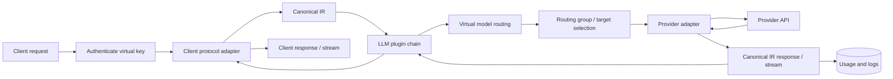

# LLM Request Path

An LLM request crosses authentication, protocol normalization, plugin phases, routing, and a provider adapter before the response is translated back; routing and plugins see the canonical IR, not vendor payloads.

`Auth` rejects an unknown or disallowed virtual key before any upstream call. `Plugins` run in configured order and can reject, rewrite, or observe the IR. `Route` resolves `virtual_model_id` to a routing group; `Select` applies priority, weight, and fallback. `Usage` is written from the canonical response so accounting is protocol-independent.

## Drift instrument

Drift caught by: inspection of the LLM data-plane pipeline plus the protocol fixture tests in `crates/octra-llm-protocol/tests/`; no generated flow oracle is wired yet.
