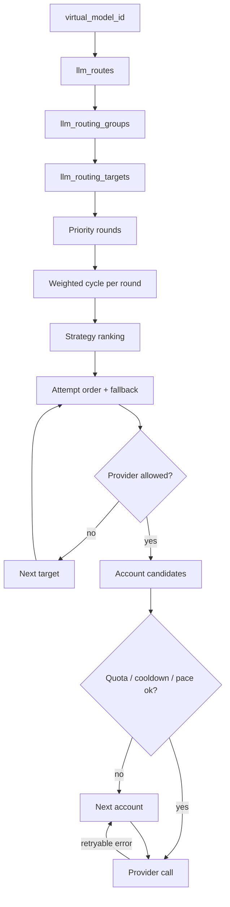

# LLM Routing and Accounts

The LLM data plane separates two decisions: which virtual model to use (route and group) and which concrete provider account should serve it. The first is static per snapshot; the second changes with quota, cooldown, pacing, latency, failures, and session affinity.

## Plan compilation

`RoutePlan::compile` reads the route's group, filters targets to providers present in the snapshot, sorts by priority, position, and id, and builds one weighted cycle per priority round. Weights are clamped to 1..=1000 for the target and 1..=20 for cycle repetition so a heavy weight does not explode the cycle. The fallback is the first target of the highest-priority round.

## Strategy ranking

`rank_targets` reorders the non-fallback attempts for these strategies:

| Strategy | Signal |
|---|---|
| `usage` | Lowest recent account usage |
| `quota` | Most remaining quota |
| `pace` | Shortest pacing wait |
| `smart` | Latency EWMA, failure EWMA, usage, and price |
| `intent` | Smart score plus client intent (`x-octra-intent`) and model capability flags |
| `semantic` | Smart score plus embedding cosine when `llm.semantic_embedding` is configured, otherwise local lexical similarity, against the target's AI-native `semantic_description` |
| `order` | Priority and position only |
| `manual` | Exact configured priority/position/id order, no rotation |
| `weight` | Priority rounds with the existing weighted cycle behavior |
| `fast` | Lowest latency EWMA, then failures and usage |
| `cheap` | Lowest input price per million, then latency and failures |
| `rotate` / `round_robin` | Rotate the flat list by the group tick |
| `priority` / default | Priority rounds and weighted cycles |

Semantic descriptions come from `ai_model_targets.semantic_description` and are carried into the runtime only in AI-native mode; nested model targets pass a description down to their leaves unless a leaf overrides it. When `llm.semantic_embedding` is configured, routing uses OpenAI-compatible embeddings with caches and a failure cooldown; otherwise it uses the local lexical vector. Targets without a description/vector receive the health score only. Targets are never removed by the strategy, and the fallback stays last.

`free`, `drain`, and `expiring` are not implemented; an unrecognized strategy is rejected by the AI-native control API. This is a deliberate v0.1 boundary, not full magpie parity.

## Account selection

The account pool keeps live state across snapshot swaps:

- quota usage and reset time (requests, tokens, or cost micros),
- cooldown after a 429/quota error,
- optional request pacing (`requests_per_minute`, `burst`),
- latency EWMA and failure EWMA,
- session affinity through the configured `x-octra-session` header.

`accounts::candidates` filters unavailable accounts and orders the rest by the plan strategy. A 429 or quota error marks the account for cooldown and continues with the next candidate. A virtual key can restrict allowed accounts; an empty candidate set is a `503 account_unavailable`.

## Attempt budget

The data plane caps upstream attempts (`MAX_ATTEMPTS = 3`). Each attempt consumes one budget slot. A non-retryable error stops the target loop; a retryable error continues to the next account or target. The fallback target is appended after the ranked attempts so ranking never duplicates it ahead of the remaining candidates.

## Drift instrument

Drift caught by: the routing and account tests in `crates/octra-llm-gateway/src/routing.rs`, `crates/octra-llm-gateway/src/similarity.rs`, `crates/octra-llm-gateway/src/accounts.rs`, `crates/octra-llm-gateway/tests/ai_runtime.rs`, and `crates/octra-llm-gateway/tests/data_plane.rs`. A future fixture should assert the full attempt order for each strategy with a mixed account state.
