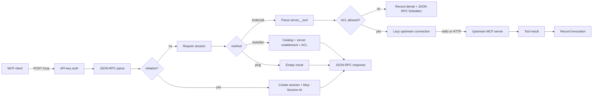

# MCP Request Path

The MCP gateway fronts many upstream MCP servers behind one `/mcp` endpoint. It terminates the client session, authenticates the caller, aggregates tool listings, enforces per-tool ACLs, and forwards tool calls to a stdio or Streamable HTTP upstream.

## Endpoint and session

- `POST /mcp` accepts a JSON-RPC request, notification, or batch. A notification with no reply returns `202 Accepted`; a request returns a JSON or batch response.
- `initialize` negotiates a protocol version from `2025-06-18`, `2025-03-26`, and `2024-11-05`, creates an Octra session row, and returns `Mcp-Session-Id`. The session is anchored to the first enabled server because `mcp_sessions.server_id` is non-null.
- Every request other than `initialize` must carry the session header. `ping`, `tools/list`, and `tools/call` validate it.
- `GET /mcp` holds an SSE channel with a 15-second keepalive. Octra does not push server-initiated notifications yet.
- `DELETE /mcp` terminates the session; later requests with the same id fail.

## Authentication and ACL

- MCP API keys are read from `Authorization: Bearer` or `X-API-Key`; only a display prefix and SHA-256 hash are stored. With no enabled keys, the loopback-local default is open.
- A key maps to an optional consumer. A tool with no ACL rows follows the open-local ACL default (allow); a tool with ACL rows is callable only by a consumer holding an allow rule. Anonymous callers are denied when ACL rows exist.
- Every denial is recorded as an invocation row with the denied status and the error message.

## Tool discovery and naming

- Discovery connects to each server, performs `initialize`, follows `tools/list` cursors (up to 50 pages), validates tool names, and replaces the persisted catalog for that server.
- The external name is `<server>__<tool>`. Both segments are validated; the separator is reserved.
- `tools/list` returns only tools whose server and tool are enabled and whose ACL allows the caller.
- `tools/call` parses the namespace, resolves the server and tool, re-checks enablement and ACL, then calls the upstream.

## Upstream transports

- **Streamable HTTP:** JSON-RPC POSTs to the server URL; responses can be `application/json` or `text/event-stream`; the upstream `Mcp-Session-Id` and protocol version are echoed after `initialize`.
- **stdio:** one child process per server; newline-delimited JSON-RPC over stdin/stdout; request ids are correlated through oneshot channels; an abandoned call is drained before the next request; the child is killed on drop.
- Connections are lazy and keyed by the full server definition. A failed call is retried once after the connection is restarted; a reload drops every live connection.

## Audit

Each call, denial, and unknown tool (when the server is identifiable) writes an `mcp_invocations` row with server, tool, consumer, request id, status (`ok`, `error`, `timeout`, `denied`, `not_found`), duration, and error. The control API exposes the rows at `/api/v1/mcp/invocations`.

## Drift instrument

Drift caught by: `crates/octra-mcp-gateway/tests/http_data_plane.rs`, `stdio_transport.rs`, `control_plane.rs`, and inspection of `crates/octra-mcp-gateway/src/data.rs`, `servers.rs`, `http.rs`, and `stdio.rs`. A future fixture should run a stdio server and an HTTP server together and assert aggregation, ACL, and audit in one session.
