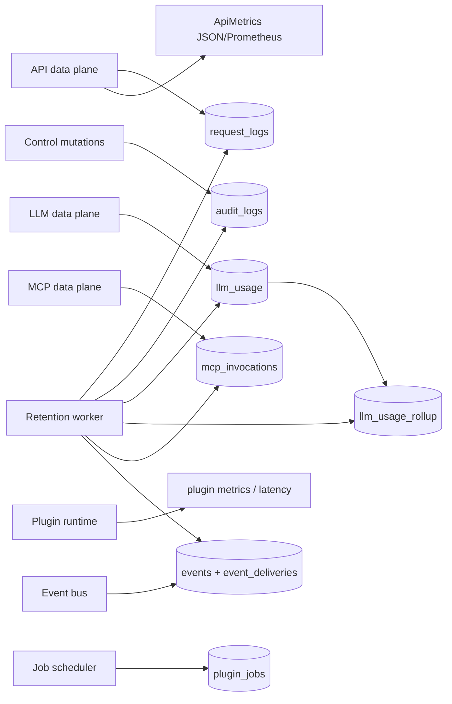

# Observability and Retention

Octra keeps operational history in the same SQLite database as configuration. The request path writes logs asynchronously; control mutations write audit rows; LLM usage is recorded from the canonical response; the retention worker bounds every append-only table.

## Surfaces

- **Request logs:** method, path, status, latency, route, service, target, consumer, error; queried at `/admin/logs`.
- **Audit logs:** actor, action, target, detail; every control mutation; queried at `/admin/audit-logs`.
- **LLM usage:** request id, virtual model, provider, model, account, API key, protocol, status, latency, input/output/cache/reasoning tokens, finish reason, cost, error. Hourly rollups feed the overview and usage pages.
- **MCP invocations:** server, tool, consumer, request id, status, duration, error.
- **Metrics:** API request counts/latency/status and upstream errors; JSON at `/admin/metrics`, Prometheus at `/admin/metrics/prometheus`; LLM plugin stage metrics at `/admin/llm/plugins/metrics`; plugin metrics at `/admin/plugin-metrics`.
- **Events and jobs:** outbox rows and delivery attempts at `/admin/events`; job schedule and last result at `/admin/jobs`.
- **Tracing:** `octra-observability` initializes `tracing` with pretty or JSON output and an env-filter level.

## Retention

The default policy is enabled with hourly runs and a batch size of 5000:

| Data | Default retention |
|---|---|
| `llm_usage` | 90 days |
| `request_logs` | 30 days |
| `mcp_invocations` | 90 days |
| `audit_logs` | 365 days |
| `llm_usage_rollup` | 400 days |
| completed/failed `events` | 7 days |
| pending events | never pruned |

A window of `0` keeps rows forever. `llm_usage_days` must be `0` or at least 32 so a monthly virtual-key limit can see a full window.

## Known gaps

- The plugin operational view does not expose event delivery lag or retry counts yet (ADR 0009 follow-up).
- The API metrics store is in-memory; a daemon restart resets counters.
- There is no OTLP export or external metrics sink; the local JSON/Prometheus endpoints are the boundary.
- Reload failures and MCP connection restarts are logged but not counted in a dedicated metric.

## Drift instrument

Drift caught by: `crates/octra-storage/src/maintenance.rs` tests, `crates/octra-storage/src/events.rs`, `crates/octra-api-gateway/src/metrics.rs`, and inspection of the control operations handlers. A future test should assert every append-only table is covered by the retention policy.
