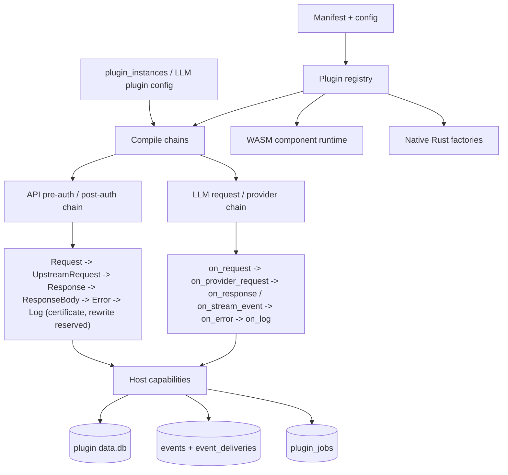

# Plugin Runtime

Octra has two plugin contracts (API and LLM) and two runtime tiers (native Rust and sandboxed WASM). The host compiles configured instances into chains once per mutation; the data plane performs map lookups and in-memory calls.

## API plugins

- Phases: the contract declares `certificate`, `rewrite`, `request`, `upstream_request`, `response`, `response_body`, `error`, and `log`. The HTTP data plane currently executes `request`, `upstream_request`, `response`, `response_body`, `error`, and `log`; `certificate` and `rewrite` are reserved and not invoked yet.
- Scope precedence: the 12 Kong combinations from consumer + route + service down to global. Consumer and consumer-group instances are deferred until after authentication.
- Ordering: manifest priority descending, then plugin name ascending; `ordering.before` / `ordering.after` can override.
- Fail policy: `fail_open` or `fail_closed` from the manifest; a closed failure returns a gateway error.
- Capabilities: request/response headers, request/response bodies, log, KV, network, secret, storage entities, auth, admin API, events, jobs.
- Built-ins: `correlation-id`, `cors`, `rate-limiting`, `circuit-breaker`, `header-rewrite`, `key-auth`, `basic-auth`, `jwt`, `acl`, `ip-restriction`, `request-size-limiting`, `request-termination`, `request-transformer`, `response-transformer`.

## LLM plugins

- Stages: `on_request`, `on_provider_request`, `on_response`, `on_stream_event`, `on_error`, `on_log`, `on_final_response`.
- Scopes: virtual key, consumer, model, provider, global.
- Built-ins: `budget-guard`, `intent-hint`, `request-audit`, `model-map`, `param-override`, `rate-limit`, `llm-pii-redaction`, `system-prompt`, `think-tags`, `llm-prompt-guard`, `llm-prompt-compress`, `llm-semantic-cache`.
- The plugin sees the canonical IR, response headers, usage, and stream events. It can reject, rewrite, replace stream events, short-circuit with a cached canonical response at the request stage, or add response headers. `on_final_response` runs after every response transform and before protocol encoding; it is read-only and best-effort.

## Runtime tiers

- **Native:** first-party Rust factories registered in the daemon. They have full host access and no WASM overhead.
- **WASM:** third-party components with a WIT ABI, a manifest, approved capabilities, fuel/memory/timeout/body limits, and a host-owned per-plugin SQLite database. The API plugin contract version is 2 (events and jobs); the LLM plugin contract version is 6.
- **Install/upgrade:** artifacts are stored with a hash, optional Ed25519 signature, manifest, and approved capabilities. A plugin instance is compiled only after the artifact passes layout and signature policy. Uninstall keeps plugin data unless `purge=true`; destructive migrations need explicit approval.

## Storage

Each plugin name gets its own SQLite database under the plugin root. The host owns DDL and applies ordered migrations; plugins use a capability-gated entity/KV API, never raw SQL. The database is bounded by `plugins.max_plugin_db_bytes`.

## Events and jobs

- `api.request.completed` is published by the API gateway when a subscriber matches the topic.
- Subscribed events are persisted in `events`; one `event_deliveries` row is created per matching subscriber. Delivery is at-least-once with exponential backoff and bounded attempts.
- Scheduled jobs are declared in the manifest, reconciled into `plugin_jobs` on each tick, and run with the plugin timeout. Terminal events are pruned by retention; pending events are never pruned.
- The control API exposes `/admin/events`, `/admin/events/{id}`, `/admin/jobs`, and `/admin/jobs/{id}/run`.

## Drift instrument

Drift caught by: `crates/octra-api-plugin-runtime` unit tests, `crates/octra-api-plugin-wasm/tests/`, `crates/octra-api-gateway/tests/plugins/`, `crates/octra-llm-plugin-runtime` tests, and `crates/octra-llm-plugin-wasm/tests/wasm_e2e.rs`. The event bus itself has no integration test yet (ADR 0009 follow-up).
