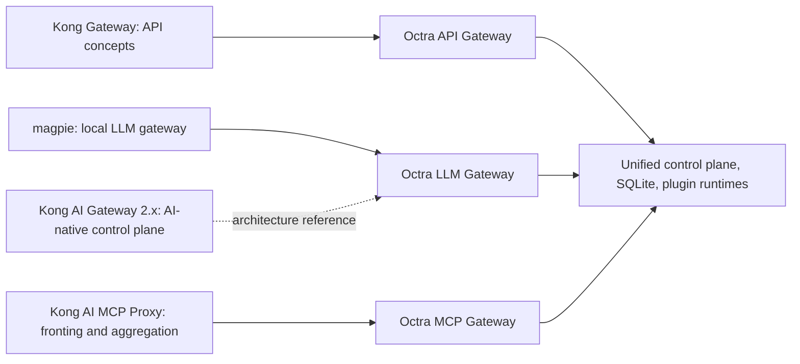

# Reference Models

Octra is a local-first composite of three primary product references. Kong AI Gateway 2.x is a secondary architecture reference for the LLM control plane: Octra borrows its AI-native entity separation and policy attachments, but not its Konnect/hybrid deployment. This view records what was studied, what was adopted, what was rejected, and where the current code still differs. It is the bridge between the research and the ADRs; the ADRs hold the decisions, and the PRD holds the acceptance status.

## API gateway — Kong Gateway

**Adopted**

- `service`, `route`, `upstream`, and `target` entities, with a Service pointing at a direct URL or an Upstream virtual host.
- Route matching on protocol, host, path, method, and headers; route ordering by `regex_priority`, longest path, then id.
- Round-robin, weighted round-robin, and consistent hashing with Kong-style `hash_on` / `hash_fallback` inputs.
- Passive and active health checks driven by the Upstream `healthchecks` document.
- Kong-style plugin phases and the 12-level scope precedence matrix, including consumer groups.
- Kong-shaped Admin API under `/admin` with `{data, next, offset}` list envelopes.
- Consumer, credential, ACL, and API-key concepts; trusted-proxy client IP resolution.

**Not adopted**

- Kong's Nginx data path, Lua plugin ABI/PDK, workspaces, RBAC, Dev Portal, Vitals, and full Admin API compatibility.
- Sticky-session cookies are implemented for cookie-hashed upstreams; `least-connections` and `latency` use in-flight and latency-EWMA signals.
- A declarative Kong configuration file as the source of truth; SQLite is the source of truth.

**Current status**

| Capability | Status | Evidence / gap |
|---|---|---|
| Service/route/upstream/target CRUD | Implemented | `/admin/*`, `migrations/0009_gateway_entities.sql` |
| Route matching and priority | Implemented | `crates/octra-runtime/src/matcher.rs` |
| Round-robin, weighted, consistent hashing, least-connections, latency | Implemented | `crates/octra-runtime/src/balancer.rs` |
| Active/passive health checks | Implemented | `balancer.rs`, `check_health` loop |
| Plugin phases and 12-level scopes | Implemented | `crates/api_gateway/octra-api-plugin-runtime/src/lib.rs` |
| Kong-shaped Admin API | Implemented | `crates/api_gateway/octra-api-gateway/src/admin/` |
| UI/CLI CRUD for API entities | Implemented | Desktop typed forms and `octra services/routes/upstreams/targets` |

## LLM gateway — yetone/magpie

**Adopted**

- One local endpoint speaking OpenAI Chat Completions, OpenAI Responses, Anthropic Messages, and Gemini.
- Protocol translation through the canonical IR, including streaming and tool calls.
- Virtual models and routing groups with priority rounds, weighted cycles, and fallback.
- Provider accounts with static or OAuth credentials, quota, cooldown, pacing, and EWMA health.
- Virtual-key and consumer policies for allowed models/providers/accounts and token/cost limits.
- Usage, cost, hourly rollups, and retention.
- Opt-in reversible or irreversible privacy masking with local or loopback engines.
- Agent configuration adapters that point Claude Code, Codex, and OpenCode at the gateway.

**Not adopted**

- magpie's signed-in subscription discovery, menu-bar app, remote sharing, Docker/NAS mode, prompt/skill library, and Bun/JavaScript plugin runtime.
- magpie's classifier-based intent routing; Octra ranks on a client-supplied `x-octra-intent` header.

**Current status**

| Capability | Status | Evidence / gap |
|---|---|---|
| Four ingress protocols + IR | Implemented | `crates/llm_gateway/octra-llm-protocol`, `crates/llm_gateway/octra-llm-core` |
| Vertex and Bedrock Converse upstream adapters | Implemented | `adapter.rs`, `octra-llm-protocol/src/bedrock/`, `data_plane/stream.rs` |
| Streaming, tool calls, usage | Implemented | `crates/llm_gateway/octra-llm-gateway/src/data_plane/` |
| Virtual models and routing groups | Implemented | `routing.rs`, `migrations/0003_llm_gateway.sql` |
| Priority/order/manual/weight/rotate/fast/cheap/free/drain/expiring/smart/usage/quota/pace/intent | Implemented | `routing.rs`, `data_plane/mod.rs` |
| Provider accounts, quota, cooldown, pacing | Implemented | `accounts.rs` |
| OAuth refresh | Implemented, encrypted at rest | `credentials/`, `octra-secrets/`, `migrations/0026_drop_legacy_llm_models.sql` |
| Virtual-key and consumer policies | Implemented, with consumer-policy Admin API, CLI, and desktop editor | `vk_policy.rs`, `runtime.rs`, `/admin/policies` |
| Usage, cost, rollups, retention | Implemented | `usage.rs`, `cost.rs`, `migrations/0014_usage_analytics.sql` |
| PII masking | Implemented, opt-in | `llm-pii-redaction`, `pii/` |
| Agent config adapters | Implemented | `crates/octra-agent-core`, ADR 0008 |
| AI-native LLM control plane | Phase 35 AI-native only: control API + full policy execution + semantic routing + streaming cache + all routing strategies + Vertex/Bedrock adapters with SigV4 + encrypted secrets + typed forms + Kong-shaped MCP + daemon lifecycle | `ai_*` schema, compiler, store, `/api/v1/ai/*` CRUD, apply/revisions/rollback, transactional replace, AI-native runtime mapping, per-target model metadata, built-in policy execution for every policy type including PromptGuard, PromptCompress, and SemanticCache, semantic target routing over AI-native descriptions, provider query parameters and presets, Vertex and Bedrock Converse adapters with optional SigV4, streaming cache population and SSE replay, OAuth desktop controls and loopback callback, full CLI CRUD with stdin/file bodies, and typed desktop forms for all AI/API/MCP entities and consumer policies exist; the legacy model tables, endpoints, modes, and import path are removed without backward compatibility; see ADR 0018 and [LLM Control Plane](llm-control-plane.md) |

### Secondary architecture reference — Kong AI Gateway 2.x

magpie remains the primary LLM product reference. Kong AI Gateway 2.x contributes the control-plane shape proposed in ADR 0018:

**Adopted (target design):**

- AI Model Provider, AI Model, AI Model Target, AI Policy, and AI Policy Attachment as first-class entities.
- A virtual model that carries capabilities, formats, targets, and a balancer.
- Policies attached to scopes (global, provider, model, target, consumer group, consumer, virtual key) rather than scattered through key permissions and plugin configs.
- Config validation, dry-run, atomic apply, and revision/rollback.
- AI consumers/groups and reusable provider credentials (Octra reuses its existing consumers, virtual keys, and secret references).

**Not adopted:**

- Konnect-managed control plane and hybrid data-plane registration.
- Mandatory Redis, vector database, or Lua policy runtime.
- Kong AI Gateway 2.x's A2A `AI Agent` entity; Octra's coding-agent configuration remains a separate `coding_agents` domain.
- Enterprise workspaces, RBAC, and multi-tenant control-plane semantics.

**Current status:** Phase 47 is AI-native only: control API, full policy execution, all magpie routing strategies, semantic routing with optional embeddings, streaming cache, Vertex and Bedrock Converse adapters with optional SigV4, AI-native account OAuth with encrypted, rotatable, retirable tokens, desktop controls and loopback callbacks, cache/routing observability, provider query parameters and protocol presets, full CRUD CLI, and typed forms for AI, API Gateway, MCP, and consumer-policy entities. The `ai_*` schema, compiler, storage store, `/api/v1/ai/*` CRUD, validate/preview/apply/revisions/rollback, revision snapshots, transactional replace, AI-native runtime mapping, per-target context/capability/pricing metadata, built-in policy execution for every policy type including PromptGuard, PromptCompress, and SemanticCache, semantic target routing over AI-native descriptions with embedding vectors and lexical fallback, provider query parameters and presets, streaming cache population and SSE replay, account OAuth endpoints, complete CLI CRUD, Kong-shaped MCP routes/CEL/OIDC discovery+introspection/OpenAPI conversion/notifications, API sticky sessions, event-delivery metrics + optional OTLP, daemon version handshakes, and the AI Control page are implemented and tested. The legacy model tables, `/admin/llm/*` model endpoints, `legacy`/`shadow`/`on` modes, and import-legacy path are removed. Signed/notarized release execution and OpenAPI 3.1 edge-case parity remain future work. See ADR 0018 and [LLM Control Plane](llm-control-plane.md).

## MCP gateway — Kong AI MCP Proxy

**Adopted**

- Fronting upstream MCP servers behind one managed endpoint; the `passthrough-listener` / `listener` half of Kong's model.
- Streamable HTTP ingress at `/mcp` with `initialize`, `ping`, `tools/list`, `tools/call`, and session binding.
- Tool aggregation with a stable `<server>__<tool>` namespace.
- API-key authentication and per-consumer, per-group, and per-tool-default ACLs.
- Invocation audit rows for calls, denials, and unknown tools.

**Not adopted**

- Kong's tag-based `listener` aggregation beyond explicit `sources`, and non-HTTP upstream modes beyond stdio/HTTP.
- Kong auth plugins beyond OIDC JWKS/discovery/introspection and Octra MCP API keys; no private_key_jwt, mTLS, revocation, or token acquisition.
- Kong's plugin-based MCP proxy model; Octra's MCP gateway is a first-class router, and API/LLM plugin chains do not run on MCP traffic.
- OpenAPI 3.1-only schema constructs, recursive/cyclic external schemas, multipart `encoding` metadata, nested `deepObject` beyond one level, and `file:` external references.
- MCP protocol revision `2025-11-25`; Octra negotiates `2025-06-18`, `2025-03-26`, and `2024-11-05`.
- Resource/prompt subscription notifications, notification replay, stdio server-initiated requests, session sharing, and non-HTTP upstreams beyond stdio.

**Current status**

| Capability | Status | Evidence / gap |
|---|---|---|
| Single global + scoped `/mcp` endpoints | Implemented | `data.rs`, `route_path` |
| Streamable HTTP + stdio upstreams | Implemented | `http.rs`, `stdio.rs` |
| Sessions and DELETE | Implemented | `data.rs`, `mcp_sessions` |
| Tool discovery and aggregation | Implemented | `servers.rs`, `mcp_tools` |
| `<server>__<tool>` namespace | Implemented | `octra-mcp-core/src/protocol.rs` |
| MCP API keys | Implemented | `auth.rs`, `mcp_api_keys` |
| Kong-shaped server type/sources | Implemented | `mcp_servers.mode/sources_json`, listener aggregation |
| Server-default + per-tool ACL | Implemented | `mcp_server_acls`, `mcp_tool_acls`, two-tier precedence |
| Consumer/group/default tool ACL | Implemented | `mcp_tool_acls`, `acl_allows_scoped` |
| CEL allow/deny ACL | Implemented | `cel-interpreter`, server `acl_*_when_json` |
| OIDC auth strategy | Implemented, JWKS + discovery + introspection | `mcp_auth_strategies`, `auth.rs` |
| OpenAPI-to-MCP conversion | Implemented subset | JSON/YAML 3.x, path/query/header/cookie/body styles, external refs; `conversion.rs` |
| Server-initiated notifications | Implemented, live-only | HTTP GET SSE + stdio forwarding, `tools/list_changed` refresh |
| Invocation audit | Implemented | `mcp_invocations` |

## Desktop and control plane

The UI is a live control-plane console with targeted editors. Overview, API Gateway, LLM Gateway, MCP Gateway, Agents, Plugins, and Settings all read live data. AI Control, API Gateway, MCP, and consumer policies expose typed-form CRUD; agents, LLM plugin enable/disable, PII model actions, and event-delivery statistics retain their mutation/observability surfaces. The Tauri host holds the control token, exposes one path- and method-allow-listed bridge command plus daemon lifecycle commands, adds a narrow loopback OAuth callback listener, checks daemon/desktop version compatibility, and can supervise a bundled daemon sidecar (ADR 0015).

## Sources

The external documentation below was reviewed on 2026-11-07. Kong references reflect the current Kong developer documentation; magpie references reflect the repository main branch at that time. Treat the linked pages, not this summary, as the authority for upstream behavior.

- Kong Gateway proxying: https://developer.konghq.com/gateway/traffic-control/proxying/
- Kong Gateway routes: https://developer.konghq.com/gateway/entities/route/
- Kong Gateway services: https://developer.konghq.com/gateway/entities/service/
- Kong Gateway upstreams: https://developer.konghq.com/gateway/entities/upstream/
- Kong Gateway targets: https://developer.konghq.com/gateway/entities/target/
- Kong load balancing: https://developer.konghq.com/gateway/traffic-control/load-balancing-reference/
- Kong health checks: https://developer.konghq.com/gateway/traffic-control/health-checks-circuit-breakers/
- Kong plugins: https://developer.konghq.com/gateway/entities/plugin/
- Kong AI Gateway 2.x concepts: https://developer.konghq.com/ai-gateway/ai-gateway-v2-concepts/
- Kong AI Gateway architecture: https://developer.konghq.com/ai-gateway/architecture/
- Kong AI MCP Proxy: https://developer.konghq.com/plugins/ai-mcp-proxy/
- Kong MCP aggregation: https://developer.konghq.com/ai-gateway/v1/mcp/aggregate-mcp-tools/
- magpie: https://github.com/yetone/magpie
- magpie routing: https://github.com/yetone/magpie/blob/main/docs/subsystems/gateway-routing.md
- MCP specification 2025-06-18: https://modelcontextprotocol.io/specification/2025-06-18

## Drift instrument

Drift caught by: comparing this table with the code paths named in each row, the ADR verification criteria, and the PRD implementation-status table. There is no generated reference-conformance test yet; a future fixture should assert the adopted/not-adopted boundaries (for example, that external `$ref`s and CEL-incompatible expressions are rejected while the documented scopes are accepted).
