# Octra Constitution

## Product

Octra is a local-first unified gateway for developers and AI agent users. It runs one authenticated runtime on the user's machine that proxies API traffic and exposes LLM and MCP services through a single control plane, with a cross-platform desktop app and CLI for management.

The product has three protocol surfaces and one management surface:

- an API gateway for arbitrary HTTP APIs, modeled on Kong Gateway;
- an LLM gateway for coding agents and LLM clients, modeled on yetone/magpie;
- an MCP gateway that fronts upstream MCP servers, modeled on Kong's AI MCP Proxy;
- a desktop console, CLI, and control API over the same SQLite state.

## Scope Boundaries

**In scope:**

- A local daemon that unifies API, LLM, and MCP gateways behind one control plane and one persistence layer.
- Kong-style API routing, upstreams, health checks, plugins, consumers, and a Kong-shaped Admin API.
- LLM protocol compatibility, virtual models, routing groups, provider accounts, virtual-key governance, usage/cost accounting, and opt-in PII masking.
- MCP fronting, tool aggregation, sessions, API keys, consumer/consumer-group/tool-default ACLs, and invocation audit.
- Detection, preview, atomic apply, backup, and restore of Claude Code, Codex, and OpenCode configuration.
- First-party Rust plugins and sandboxed third-party WASM plugins, including durable events and scheduled jobs.
- A Tauri desktop app, a browser frontend, and an administrative CLI over the same control API.
- A live desktop console with a token boundary that keeps the control token out of the webview.

**Explicitly out of scope:**

- A cloud control plane, remote multi-user administration, or a distributed gateway cluster.
- PostgreSQL, MySQL, Redis, Elasticsearch, or any required external database or broker.
- Complete Kong Lua plugin compatibility, Kong PDK compatibility, or a drop-in Kong Admin API replacement.
- magpie's signed-in subscription discovery, menu-bar app, remote sharing, Docker/NAS mode, or Bun/JavaScript plugin runtime.
- Rust dynamic-library plugin loading or unsandboxed third-party native code.
- Apple signing/notarization credentials are operator-provided; packaging workflows produce unsigned bundles without them.

**Phase boundaries:**

- Phase 1 (current): single-node daemon, API/LLM/MCP gateways, SQLite persistence, native and WASM plugins, agent integration, desktop console, and CLI.
- Phase 2: signed/notarized release execution, key-retirement confirmation/audit, full OpenAPI serialization parity, additional protocol adapters, broader agent coverage, and remaining reference-model parity where justified.

## Data Model / Schema Foundation

```mermaid
erDiagram
    SERVICES ||--o{ ROUTES : exposes
    SERVICES ||--o{ PLUGIN_INSTANCES : scopes
    ROUTES ||--o{ PLUGIN_INSTANCES : scopes
    CONSUMERS ||--o{ PLUGIN_INSTANCES : scopes
    CONSUMER_GROUPS ||--o{ PLUGIN_INSTANCES : scopes
    UPSTREAMS ||--o{ TARGETS : contains
    CONSUMERS ||--o{ KEYAUTH_CREDENTIALS : owns
    CONSUMERS ||--o{ BASICAUTH_CREDENTIALS : owns
    CONSUMERS ||--o{ JWT_SECRETS : owns
    CONSUMERS ||--o{ ACLS : owns
    CONSUMERS o|--o{ POLICIES : scopes
    CONSUMERS o|--o{ LLM_VIRTUAL_KEYS : owns
    LLM_PROVIDERS ||--o{ LLM_MODELS : offers
    LLM_PROVIDERS ||--o{ LLM_PROVIDER_ACCOUNTS : holds
    LLM_PROVIDER_ACCOUNTS ||--o| LLM_PROVIDER_OAUTH_TOKENS : refreshes
    LLM_PROVIDERS ||--o{ LLM_ROUTING_TARGETS : serves
    LLM_ROUTING_GROUPS ||--o{ LLM_ROUTING_TARGETS : selects
    LLM_ROUTING_GROUPS o|--o{ LLM_ROUTES : aliases
    MCP_SERVERS ||--o{ MCP_TOOLS : exposes
    MCP_SERVERS ||--o{ MCP_SESSIONS : runs
    MCP_TOOLS ||--o{ MCP_TOOL_ACLS : grants
    CONSUMERS o|--o{ MCP_TOOL_ACLS : receives
    CONSUMER_GROUPS o|--o{ MCP_TOOL_ACLS : receives
    CONSUMERS o|--o{ MCP_API_KEYS : owns
    PLUGINS ||--o{ PLUGIN_CONFIGS : configures
    PLUGIN_ARTIFACTS o|--o{ PLUGINS : packages
    EVENTS ||--o{ EVENT_DELIVERIES : delivers
```

The diagram shows enforced foreign keys; usage rows and agent profile/backup rows keep logical references so history survives configuration deletion. The schema separates five planes that must not be flattened. **Identity and governance:** consumers own credentials, virtual keys, and ACLs, join consumer groups, and are scoped by policies. **API routing:** services expose routes backed by upstreams and targets. **LLM routing and accounting:** LLM routes map client-facing model aliases through routing groups to provider targets and accounts; usage and cost are append-only history. **MCP:** servers expose tools and sessions, with per-tool ACLs and invocation audit. **Operations:** requests, audits, plugin events, jobs, and agent backups are bounded history governed by retention. Secrets are stored as references, never values, except OAuth tokens in the dedicated table. The full relationship map lives in the [data-model view](/architecture/data-model.md).

## Non-negotiables

- Octra requires no cloud control plane or external database: with `$OCTRA_HOME` set, the daemon starts and serves both planes using SQLite alone.
- SQLite is the only persistence engine; the workspace has no PostgreSQL, MySQL, or Redis client dependency.
- The control plane binds loopback by default and rejects unauthenticated requests; the control token is never issued to an agent and never enters the desktop webview in packaged mode.
- Static provider credentials are stored only as `env:`/`file:` references; persisted credential material (OAuth tokens, KeyAuth keys, BasicAuth passwords, JWT secrets) is sealed with AES-256-GCM under an OS-keychain-backed master key and is never returned by the control API. Agent config backups remain protected by the database's `0600` permissions.
- Third-party plugin code runs only in the WASM sandbox with operator-approved capabilities; native plugins are first-party and compiled into the daemon.
- Every agent config mutation is backed up before it is applied and is applied atomically; restore reproduces the original file.
- PII redaction is opt-in and fail-closed when a detector engine is configured. PII values and placeholder maps are not persisted and are not sent to a cloud detector.
- The reference-model boundary is explicit: Kong and magpie concepts may be adopted, but Kong Lua/PDK compatibility, a drop-in Kong Admin API, and magpie's cloud/subscription-discovery features are not goals.
- The documentation source language is English; translations never replace or preempt the English source.
- The tracked living-docs bundle passes `living-docs check`.

## Amendment Log

- 2026-11-07: Expanded the constitution with the three reference models (Kong API, magpie LLM, Kong MCP), the five-plane schema summary, the desktop token boundary, the PII boundary, and the explicit reference-model limits. The constitution remains Draft and has not been ratified.
- 2026-11-06: Initial draft.
