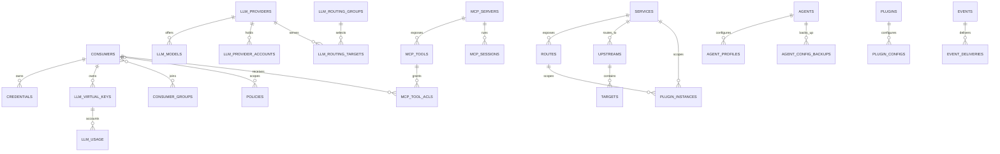

# Octra Constitution

## Product

Octra is a local-first unified gateway for developers and AI agent users. It runs one authenticated runtime on the user's machine that proxies API traffic and exposes LLM and MCP services through a single control plane, with a cross-platform desktop app and CLI for management.

## Scope Boundaries

**In scope:**

- A local daemon that unifies API, LLM, and MCP gateways behind one control plane and one persistence layer.
- LLM protocol compatibility, provider routing, virtual-key governance, and coding-agent onboarding.
- Detection, preview, atomic apply, backup, and restore of Claude Code, Codex, and OpenCode configuration.
- First-party Rust plugins and sandboxed third-party WASM plugins.
- A Tauri desktop app, a browser frontend, and an administrative CLI over the same control API.

**Explicitly out of scope:**

- A cloud control plane, remote multi-user administration, or a distributed gateway cluster.
- PostgreSQL, MySQL, Redis, Elasticsearch, or any required external database or broker.
- Complete Kong Lua plugin compatibility or a general-purpose agent runtime.
- Rust dynamic-library plugin loading or unsandboxed third-party native code.
- OS keychain integration in the current phase; secret references are the implemented boundary.

**Phase boundaries:**

- Phase 1 (current): single-node daemon, API/LLM/MCP gateways, SQLite persistence, native and WASM plugins, agent integration, desktop console, and CLI.
- Phase 2: production hardening, packaging and signing, OS keychain-backed secrets, additional protocol adapters, and broader agent coverage.

## Data Model / Schema Foundation

The schema separates three planes that must not be flattened. **Identity and governance:** consumers own credentials and virtual keys, join consumer groups, and are scoped by policies. **Routing:** services expose routes backed by upstreams and targets, while LLM routes map client-facing model aliases through routing groups to provider targets. **Accounting and operations:** usage, request logs, audit logs, plugin events, and agent config backups are append-only history governed by retention. Secrets are stored as references, never values; the full relationship map lives in the [data-model view](/architecture/data-model.md).

## Non-negotiables

- Octra requires no cloud control plane or external database: with `$OCTRA_HOME` set, the daemon starts and serves both planes using SQLite alone.
- SQLite is the only persistence engine; the workspace has no PostgreSQL, MySQL, or Redis client dependency.
- The control plane binds loopback by default and rejects unauthenticated requests; the control token is never issued to an agent.
- Static provider credentials are stored only as `env:`/`file:` references; persisted credential material (OAuth tokens, agent config backups) is protected by the database's `0600` permissions and is never returned by the control API.
- Third-party plugin code runs only in the WASM sandbox with operator-approved capabilities; native plugins are first-party and compiled into the daemon.
- Every agent config mutation is backed up before it is applied and is applied atomically; restore reproduces the original file.
- The documentation source language is English; translations never replace or preempt the English source.
- The tracked living-docs bundle passes `living-docs check`.

## Amendment Log

No amendments. The constitution is still Draft and has not been ratified.
